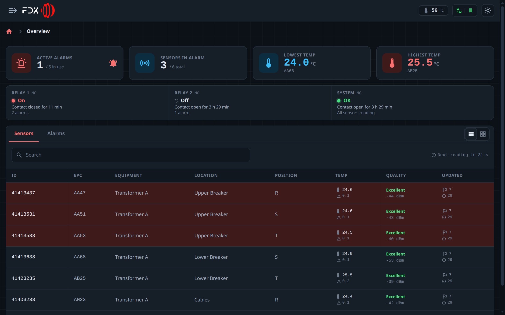
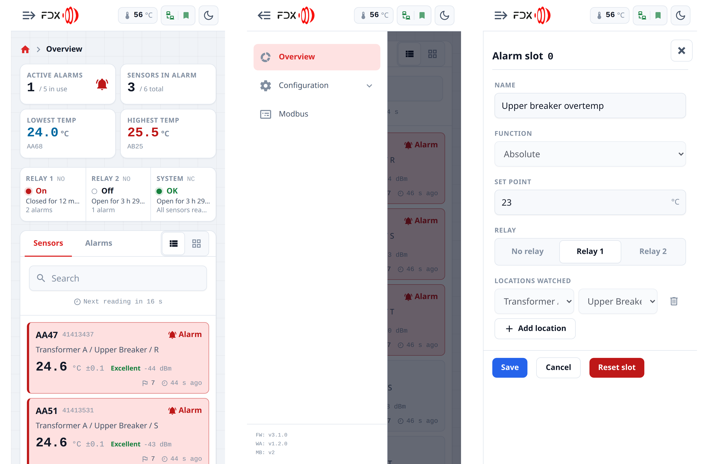

# Introduction

## About this manual

This manual describes the web application built into the FDX-HS-CM, called the HS in this
manual: how to reach it and how to use each of its views. Installation, wiring and
technical specifications of the unit are covered in the FDX-HS-CM User Manual (FDX-HS-UM-002);
the first-time setup is summarized in the Quick Guide (FDX-HS-UM-001).

> **NOTE:** The screenshots are for reference only. The interface is continuously improved and
> may differ slightly from the one on your unit.

## About the FDX-HS-CM

The FDX-HS-CM is a hot spot monitoring system. Wireless, battery-free RFID temperature sensors
are installed on the points to be monitored. The HS reads them through its antennas, evaluates the configured alarms,
drives its output relays and publishes every value over Modbus RTU to a SCADA or master system.

The HS has a built-in web application, used to:

- watch temperatures, alarms and relay states live;
- register sensors and give each one a place (equipment, location and position);
- configure alarms and the relays they drive;
- configure the Modbus link and the RFID reader.

The web application needs no software on your computer: any modern browser works (Chromium,
Chrome, Firefox, Edge, Safari), on a desktop, a tablet or a phone.

## Connecting to the device

The HS publishes its own Wi-Fi access point. The access point is off during normal operation.

1. Press and hold the Wi-Fi button of the HS until the blue LED marked **WIFI** on the enclosure
   turns on (about **5 seconds**). The LED on means the access point and the web application are
   ready.
2. On your computer or phone, connect to the Wi-Fi network **`fdx-hs-<serial>`**, where
   `<serial>` is the serial number of the unit. Use the Wi-Fi password supplied by FDX.
3. Open a browser and go to **`http://192.168.10.1`**.

The access point turns itself off after **60 minutes**. You can change this time for the current
session in [System > Wi-Fi session](components/system.md#wi-fi-session). When the access point
turns off, the page stops updating; press the button again to reconnect.

### Light and dark theme

The web application has a light theme and a dark theme. Switch between them at any time with
the theme button at the right end of the top bar (moon or sun icon). Your browser remembers the
choice. The screenshots in this manual use the light theme.

### Phones and tablets

The web application adapts to the screen it is opened on, so the same functions are available on a
computer, a tablet or a phone:

- the side menu opens over the page with the menu button and closes after you pick an entry;
- tables become one card per sensor or alarm, with the name and the reading first;
- edit panels take the whole screen, with their buttons fixed at the bottom;
- buttons and list entries grow to be easy to tap.

Phones work in portrait and landscape orientation. The screenshots in this manual are taken on a
computer; on a phone the content and the buttons are the same, only arranged differently.

## Getting started: commissioning a new unit

The usual order to put a new HS into service:

1. **Connect** to the device (see above).
2. **[System](components/system.md)**: set the Modbus address, baud rate and parity of your
   SCADA link.
3. **[RFID Config](components/rfid-config.md)**: select the radio region of your country.
4. **[Labels](components/labels.md)**: name your equipment, locations and positions.
5. **[Sensors](components/sensors.md)**: run discovery and give each sensor its place, one by one
   or with **Quick setup**.
6. **[Alarms](components/alarms.md)**: create the alarms and choose the relay each one drives.
7. **[Overview](components/overview.md)**: confirm that every sensor reports a temperature and the
   **System** relay shows **OK**.
8. **[Modbus](components/modbus.md)**: give the register map to the SCADA integrator.
