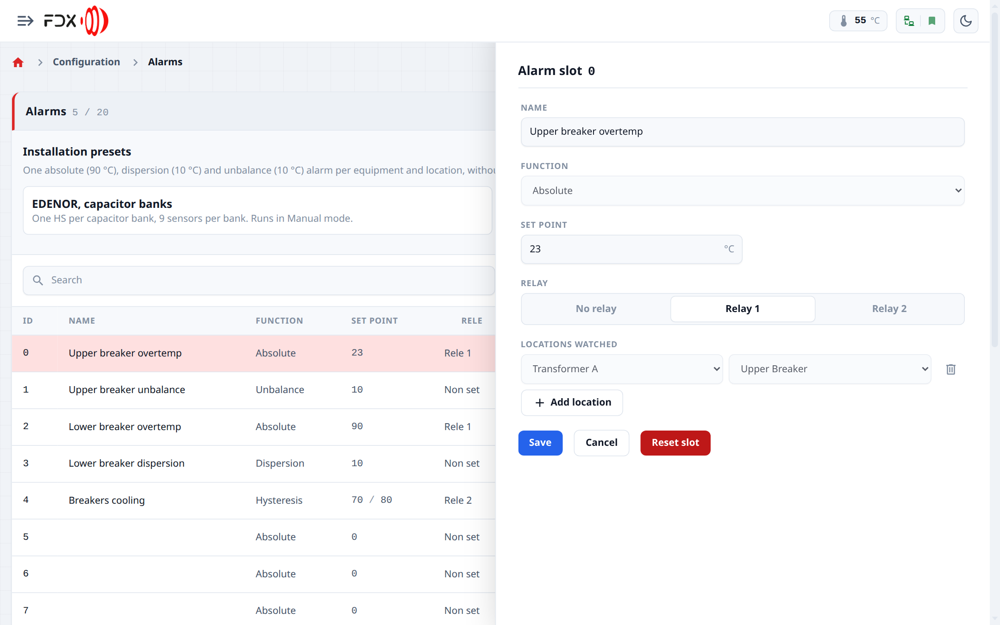

# Alarms: installation presets

| | |
|---|---|
| **View** | [Alarms](../components/alarms.md) |

## Installation presets

Reveal the presets with the gesture on the **Alarms** title (**Ctrl + Shift + double click** on a
computer, **press and hold** on a touch screen).

A preset writes a standard set of alarms for a typical installation: one **Absolute** (90 °C),
one **Dispersion** (10 °C) and one **Unbalance** (10 °C) alarm per equipment and location,
without relay. Some presets ask which bank the unit watches.

1. Load and save the matching preset in [Labels](labels.md) first. The preset uses the label
   names, and lists any name missing on the device.
2. Pick the preset. The panel previews the alarms and the slots they take.
3. Press **Apply preset** and confirm. The listed slots are overwritten and **every other slot is
   cleared**.
4. Review the alarms and assign relays where needed.
