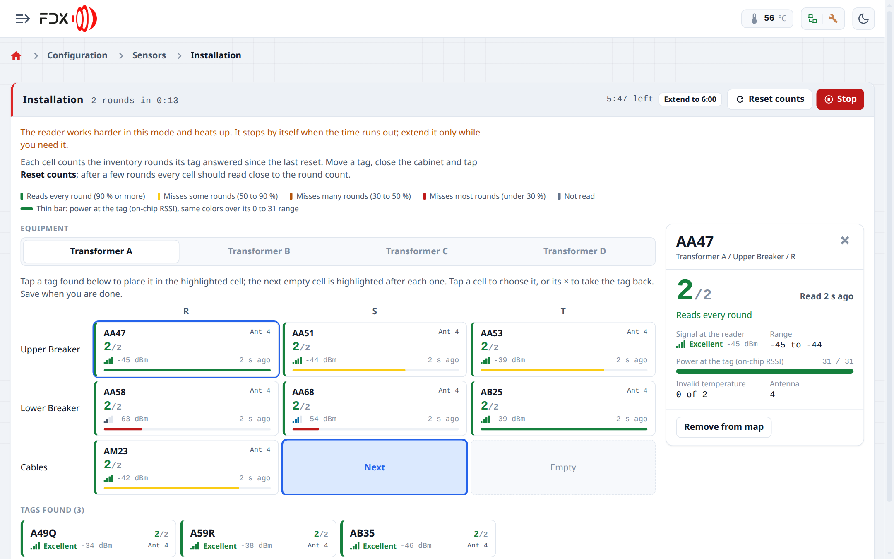

# Installation

| | |
|---|---|
| **Route** | `/configuration/installation` |
| **Menu** | None. Opened from [Sensors](../components/sensors.md) with the admin gesture on the **Unconfigured sensors** title. |

A field tool to check that every sensor is read reliably in its final position, and to place new
tags on the equipment map while you work on the equipment.

While the tool runs, the reader reads continuously with the production timing and counts, for
each tag, how many inventory **rounds** it answered. A sensor in a good position answers almost
every round.

> **NOTE:** Normal operation is paused. Measuring, alarms, relays and Modbus stop while this tool is
> open and resume when you leave it. The reader works harder in this mode and heats up, so a
> session ends by itself after **6 minutes** unless you extend it.

## Starting and stopping

1. Open the tool from [Sensors](../components/sensors.md). Confirm the dialog to start.
2. The header shows **N rounds in mm:ss** (since the start or the last reset) and the time left.
3. **Extend to 6:00** resets the remaining time to 6 minutes. Extend only while you need it.
4. **Stop** ends the session and returns to Sensors.

When the session ends on time, or is stopped from another browser, the view says so and offers
**Start again**. While a session runs, the mode indicator in the top bar shows a wrench and every
other view shows the **Installation mode is on** banner, with **Open** (back to the tool) and
**Stop** (end the session) buttons.

## Reading the map

Pick the **Equipment** at the top. The map shows locations as rows and positions as columns.

Each configured sensor cell shows:

| Element | Meaning |
|---------|---------|
| **reads/rounds** (for example `48/50`) | Rounds the tag answered out of the rounds run. Colored by the scale below. |
| Left edge color | Same scale, visible at a glance. |
| **Ant N** | Antenna of the last read. |
| Warning icon and number | Readings with an unusable temperature. |
| Signal bars | Signal level at the reader. |
| Time | Time since the last read. |
| Thin bar | Power received by the tag (on-chip RSSI), same colors over its 0 to 31 range. |
| **Check tag** | The tag receives enough power but often returns an invalid temperature. It may be defective. |

Color scale (share of rounds answered):

| Color | Label | Share |
|-------|-------|-------|
| Green | **Reads every round** | 90 % or more |
| Yellow | **Misses some rounds** | 50 to 90 % |
| Orange | **Misses many rounds** | 30 to 50 % |
| Red | **Misses most rounds** | Under 30 % |
| Grey | **Not read** | No reads since the last reset |

A red counter on an equipment button tells you how many of its sensors miss most rounds or are not
read, so problems on another equipment are not missed.

## Checking a sensor position

1. Move or fix the tag, close the enclosure.
2. Press **Reset counts**.
3. After a few rounds every cell should read close to the round count.

Click a sensor cell to open the **finder** panel, with large text readable from arm's length:

| Field | Meaning |
|-------|---------|
| **reads/rounds** and **Read now** / **Read N s ago** | Live read count. **Read now** appears when the tag was read in the last second. |
| **Signal at the reader** and **Range** | Current signal and its minimum and maximum since the reset. |
| **Power at the tag** | On-chip RSSI, out of 31. |
| **Invalid temperature** | Readings with an unusable temperature. |
| **Antenna** | Antenna of the last read. |

If the sensor was not read since the reset, check that the tag faces an antenna and that nothing
metallic covers it. **Remove from map** removes the sensor from the configuration; the tag stays in
the list of tags found.

## Placing new tags

**Tags found** lists the tags read during the session that are not configured yet, with their read
count, signal and antenna. Placing works like [Quick setup](../components/sensors.md#quick-setup):

1. The highlighted cell (**Next**) receives the next tag. Tap a tag to place it there; tap a cell
   to choose another one.
2. Placed tags show **not saved**; press **×** to take one back.
3. Press **Save N sensors** to store all placements, or **Discard** to drop them.

Leaving the view or pressing **Stop** with placements not saved asks for confirmation first.
