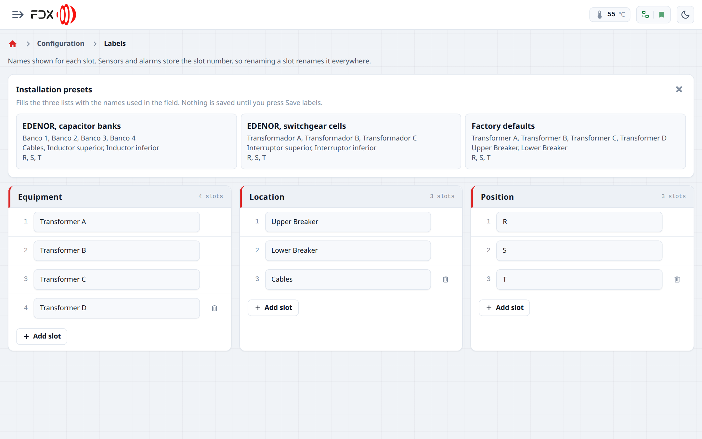

# Labels: installation presets

| | |
|---|---|
| **View** | [Labels](../components/labels.md) |

## Installation presets

Reveal the presets with the gesture on the description text at the top of the view
(**Ctrl + Shift + double click** on a computer, **press and hold** on a touch screen).

A preset fills the three lists with the names of a typical installation. Each preset card shows
the names it loads. **Factory defaults** restores the English names the device ships with;
other presets match standard installations prepared by FDX.

Loading a preset only fills the form: review the names and press **Save labels** to store them.
Load the same preset here before applying the matching alarm preset in [Alarms](alarms.md).
