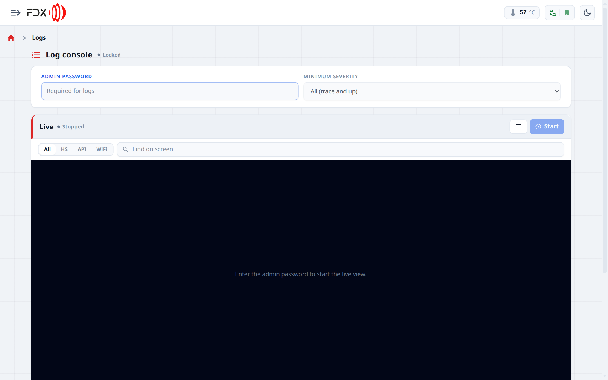

# Logs

| | |
|---|---|
| **Route** | `/admin/logs` |
| **Menu** | None. Apply the admin gesture to the version block (FW / WA / MB) at the bottom of the side menu. |

The log console shows what the services of the unit are doing, live, and downloads log files to
send to FDX support.

## Unlocking

| Field | Description |
|-------|-------------|
| **Admin password** | Required for every function of this view. The status at the top changes from **Locked** to **Unlocked** once it is typed. A wrong password is reported when you start the live view or a download. |
| **Minimum severity** | Lowest severity shown and downloaded: **All (trace and up)**, **Debug and up**, **Info and up**, **Warning and up**, **Errors only**. |

## Live

| Control | Action |
|---------|--------|
| **Start** / **Stop** | Starts or stops following the logs of every service. |
| **Pause** / **Resume** | Freezes the screen without stopping the stream. |
| Clear button | Clears the screen. |
| Service buttons | Show all services or only one. |
| **Find on screen** | Highlights the lines that contain the text. |

Each line shows the time, severity, service, module and message. The screen keeps the latest
2000 entries; download the log for the full history. When you scroll up, new lines keep arriving
and a **jump to latest** button shows how many you have not seen.

## Download

| Field | Values |
|-------|--------|
| **Source** | All services merged by time, HS main application, RFID API service, WiFi service |
| **Time range** | Last 5, 15 or 30 minutes, last hour, last 2 hours, whole current log |

Press **Download log**. The file uses the **Minimum severity** selected above and keeps the
original log format. Times are measured with the clock of the device.

## Runtime level

Folded by default. Changes how much detail each service writes to its log:

| Target | Service |
|--------|---------|
| **HS main application** | Monitoring application |
| **RFID API service (app)** | Reader service |
| **RFID API reader (driver)** | Low-level reader driver |

Pick a level (**trace**, **debug**, **info**, **warning**, **error**) and press **Apply**. The level
applies until the service restarts, then returns to its default. Use detailed levels only while
investigating a problem, as they produce much larger logs.
