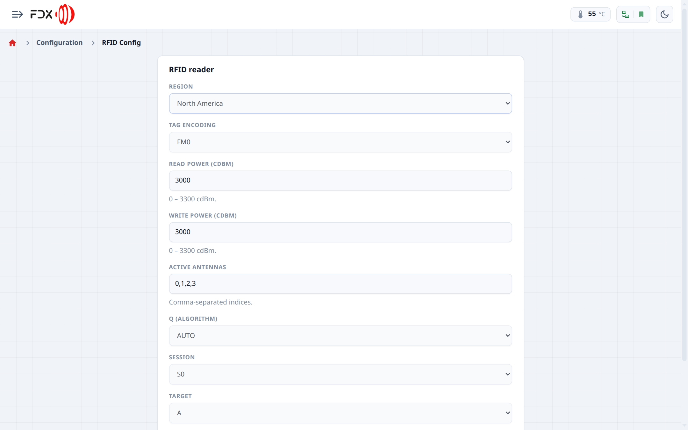

# RFID Config: advanced settings

| | |
|---|---|
| **View** | [RFID Config](../components/rfid-config.md) |

Reveal the advanced settings with the gesture on the **RFID reader** title (**Ctrl + Shift +
double click** on a computer, **press and hold** on a touch screen).

| Field | Values | Description |
|-------|--------|-------------|
| **Tag Encoding** | FM0, Miller 2, Miller 4, Miller 8 | Encoding of the tag replies. |
| **Read power (cdBm)** | 0 to 3300 | Transmit power for reading, in hundredths of dBm (3000 = 30 dBm). |
| **Write power (cdBm)** | 0 to 3300 | Transmit power for writing, in hundredths of dBm. |
| **Active antennas** | Comma separated list, for example `0,1,2,3` | Antenna ports used by the reader. |
| **Q (algorithm)** | AUTO, Q0 to Q15 | Anti-collision parameter of the inventory. |
| **Session** | S0 to S3 | Inventory session of the EPC Gen2 protocol. |
| **Target** | A, B | Inventory target of the EPC Gen2 protocol. |
| **Password** | | Admin password. Required to save the advanced fields. |

Buttons:

| Button | Action |
|--------|--------|
| **Save** | Saves the region and the advanced fields. With a wrong password the page shows **Wrong password: advanced fields were not updated**. |
| **Restore factory defaults** | After a confirmation, overwrites every reader setting with the factory values. Needs the password. |
| **Cancel** | Hides the advanced fields and discards their changes. |

Changing these values affects how reliably the sensors are read. Change them only following FDX
instructions, and check the result with the [Installation](installation.md) tool.
