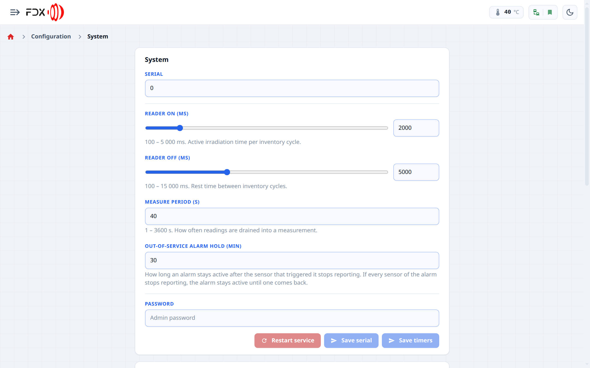
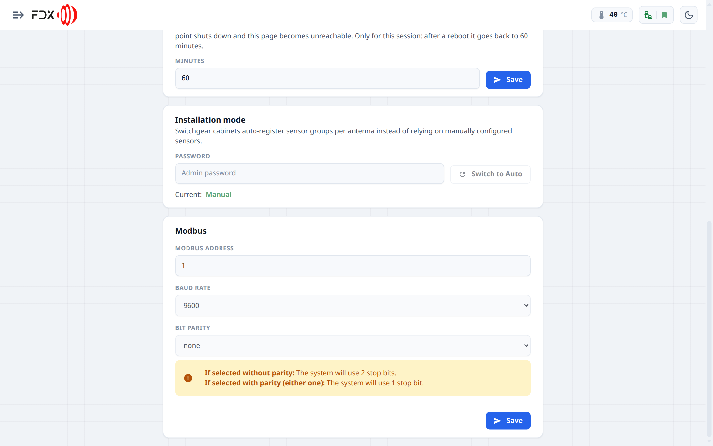

# System: service settings

| | |
|---|---|
| **View** | [System](../components/system.md) |

Reveal the admin controls with the gesture on the **System** card: **Ctrl + Shift + double
click** anywhere on the card (computer) or **press and hold** the **System** title (touch).

## Serial and inventory timers

The System card shows these editable fields:

| Field | Range | Description |
|-------|-------|-------------|
| **Serial** | Up to 8 characters | Serial number of the unit. It also names the Wi-Fi network (`fdx-hs-<serial>`). |
| **Reader on (ms)** | 100 to 5000 | Time the reader transmits in each inventory cycle. |
| **Reader off (ms)** | 100 to 15000 | Rest time between inventory cycles. |
| **Measure period (s)** | 1 to 3600 | How often the collected readings become a new measurement (temperatures, alarms, Modbus). |
| **Out-of-service alarm hold (min)** | Measure period to 1092 | How long an alarm stays active after the sensor that triggered it stops reporting. If every sensor of the alarm stops reporting, the alarm stays active until one comes back. |

Rules checked on screen:

- The **Measure period** must be at least **Reader on + Reader off** (one full inventory cycle
  per measurement). An amber message shows when this is not met and **Save timers** stays
  disabled.
- A blue recommendation appears when the measure period is below **1.5 times** (ideally 2 times)
  **Reader on + Reader off**. Saving is allowed, but a tight window may collect fewer than two
  readings and mark sensors as out of service by mistake.

At the bottom of the card:

| Control | Action |
|---------|--------|
| **Password** | Admin password, used by the three buttons below. |
| **Restart service** | Restarts the HS application after a confirmation. The page disconnects for a few seconds. |
| **Save serial** | Saves the serial number. |
| **Save timers** | Saves the four timer fields. |

With a wrong password the page shows **Wrong password** and nothing is changed.

## Installation mode (Manual / Auto)

Selects the operating mode of the unit. Despite its name, this card is not the
[Installation](installation.md) tool.

| Mode | Use |
|------|-----|
| **Manual** | Normal installations. Only the sensors you register in [Sensors](../components/sensors.md) are processed. |
| **Auto** | Sensor groups are registered automatically per antenna and followed as they change. |

**Current** shows the active mode. To change it, type the admin password in this card's own
**Password** field and press **Switch to Auto** or **Switch to Manual**. The change applies
immediately.
