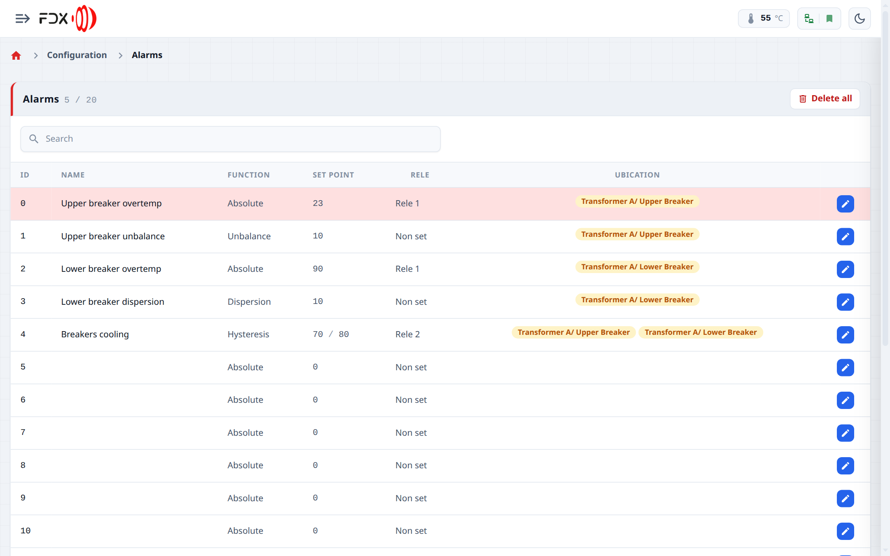
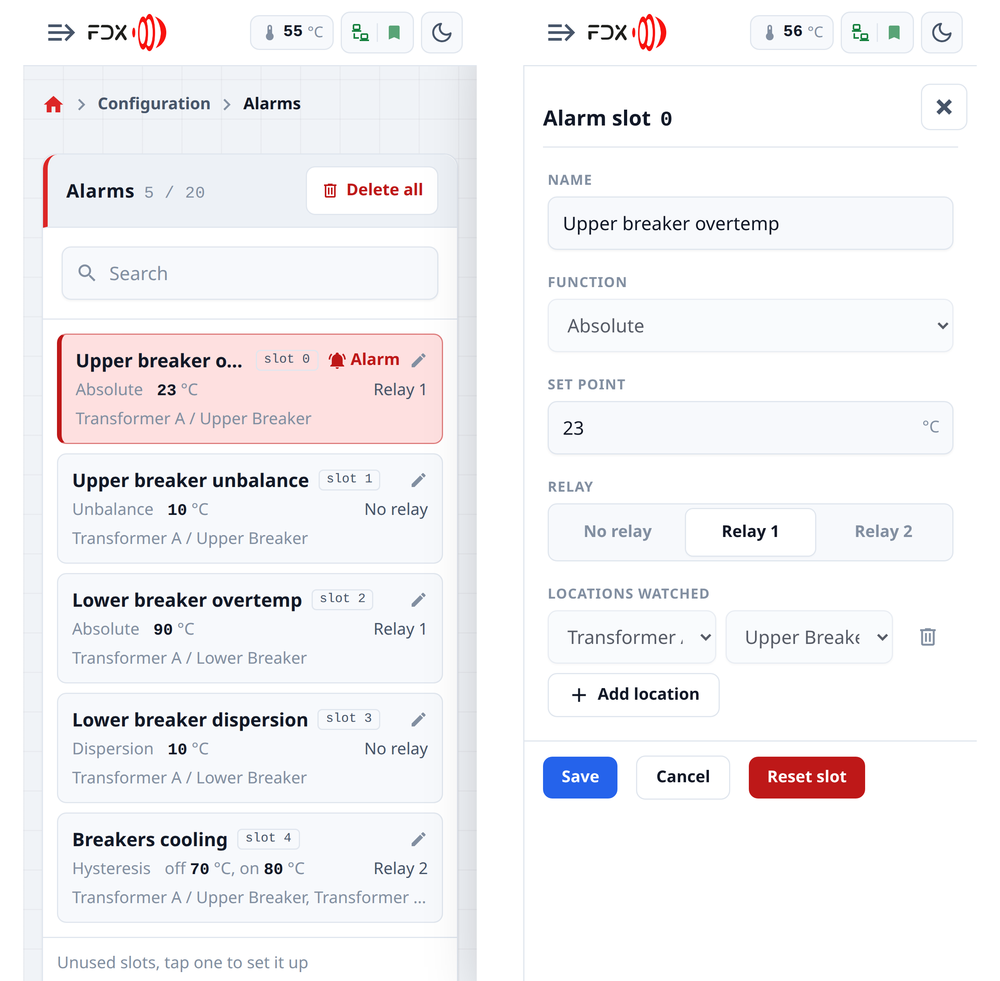
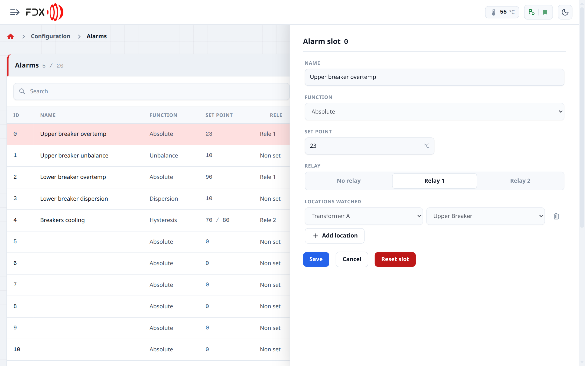

# Alarms

| | |
|---|---|
| **Route** | `/configuration/alarms` |
| **Menu** | **Configuration > Alarms** |

The unit has **20 alarm slots** (0 to 19). Each alarm watches one or more equipment locations,
applies a function to the temperatures of their sensors and, when triggered, can drive Relay 1 or
Relay 2. The number next to the title shows the slots in use out of the total.

## Alarm list

| Column | Content |
|--------|---------|
| **Id** | Slot number. |
| **Name** | Alarm name. |
| **Function** | Alarm function (see below). **Non set** means the alarm is off. |
| **Set point** | Threshold in °C. For hysteresis alarms: `off / on` thresholds. |
| **Rele** | Relay driven by the alarm: **Non set**, **Rele 1** or **Rele 2**. |
| **Ubication** | Equipment and location pairs watched by the alarm. |

Triggered alarms are highlighted in red. Use **Search** to filter by name, function or relay.
On phones the alarms in use are shown as cards, with their function, set point, relay and
locations; an active alarm has a red card with an **Alarm** flag. The unused slots are shown as a
strip of numbers below the cards: tap one to set it up. Tapping a card opens the editor on the
whole screen.

**Delete all** clears every alarm slot after a confirmation; the relays stop being driven by them.

## Editing an alarm

Click an alarm (or an unused slot) to open the **Alarm slot** panel.

| Field | Description |
|-------|-------------|
| **Name** | Required, for example "Upper section overtemp". |
| **Function** | **Not set (alarm off)**, **Absolute**, **Unbalance**, **Dispersion** or **Hysteresis**. |
| **Set point** | Threshold in °C, whole number from -40 to 120. |
| **Off below** / **On above** | Hysteresis only, see below. |
| **Relay** | **No relay**, **Relay 1** or **Relay 2**. |
| **Locations watched** | Pairs of equipment and location. Every sensor in those locations takes part in the alarm. Press **Add location** to add a row, the remove button to delete one. The same pair cannot be listed twice. |

An alarm without locations cannot trigger.

Buttons:

- **Save**: stores the slot. Enabled when the name, set points and locations are valid.
- **Cancel**: closes the panel without saving.
- **Reset slot**: clears the slot back to empty.

## Alarm functions

Out-of-service sensors are ignored by every function. All temperatures are the averages of the
last measurement window.

| Function | Triggers a sensor when |
|----------|------------------------|
| **Absolute** | Its temperature is above the set point. |
| **Unbalance** | Its temperature differs from the average of the watched sensors by more than the set point (above or below). |
| **Dispersion** | Its temperature is above the coolest watched sensor plus the set point. |
| **Hysteresis** | The alarm turns on when a sensor goes above **On above** and stays on until every watched sensor drops below **Off below**. Between both values it keeps its state, which avoids relay chatter around a single threshold. **Off below** must be lower than **On above**. |

Example: an **Unbalance** alarm with set point 10 °C on a location with three sensors triggers
when one of them runs 10 °C hotter or cooler than the average of the three.

When a sensor that triggered an alarm stops reporting, the alarm stays active for a hold time
(30 minutes by default). If every sensor of the alarm stops reporting, the alarm stays active
until one of them comes back, so a sensor that overheats until it loses signal never clears its
alarm by itself.
