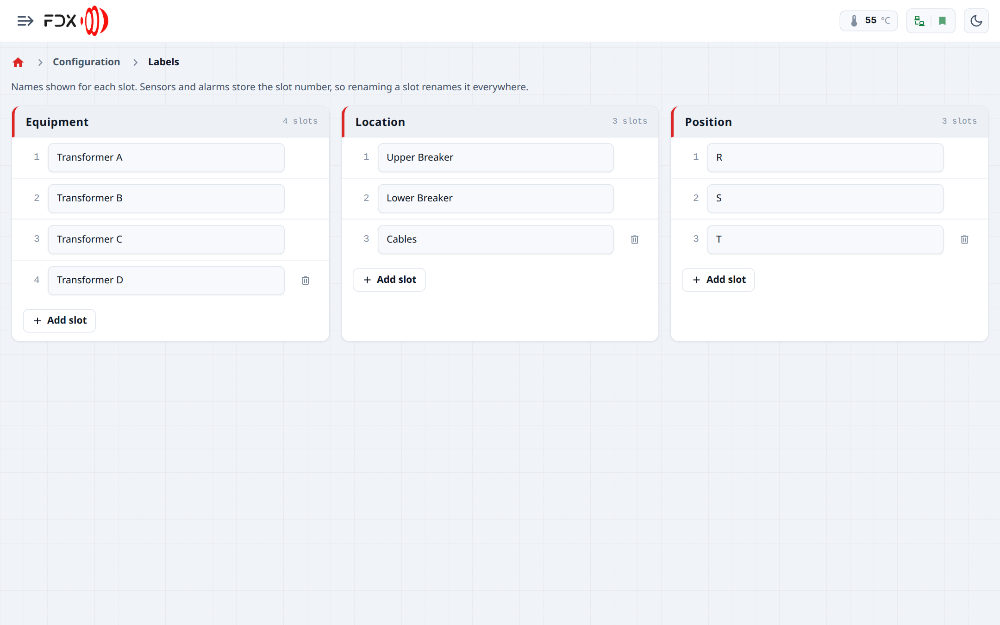

# Labels

| | |
|---|---|
| **Route** | `/configuration/labels` |
| **Menu** | **Configuration > Labels** |

Labels are the names used to describe where each sensor is installed. There are three lists:

| List | Describes | Example |
|------|-----------|---------|
| **Equipment** | The piece of equipment | Panel 1, Machine 2 |
| **Location** | A part of the equipment | Upper section, Lower section |
| **Position** | A point on that part | Left, Center, Right |

Each name occupies a numbered **slot**. Sensors and alarms store the slot number, not the name,
so renaming a slot renames it everywhere at once (Overview, Sensors, Alarms).

On a wide screen the three lists are shown side by side; on narrow screens each list is a tab.

| Action | How |
|--------|-----|
| Rename a slot | Type in its field. Up to 20 characters. Leave it empty to mark the slot as unused. |
| Add a slot | Press **Add slot** under the list. |
| Remove a slot | Only the last slot of a list can be removed, with the remove button on its row. Middle slots cannot be removed because sensors and alarms refer to them by number; leave them empty instead. |

The same name cannot be used twice in one list. Duplicated names are outlined in red and saving
is blocked until you fix them.

While there are changes to save, a bar sticks to the bottom of the view:

- **Save labels**: stores the changes on the device.
- **Discard**: returns to the names stored on the device.
