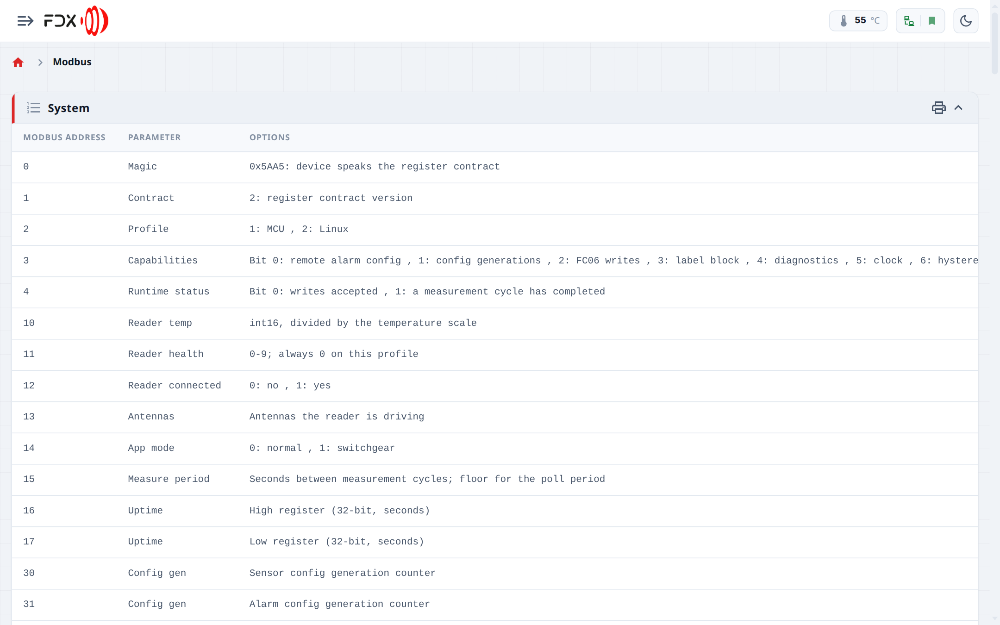

# Modbus

| | |
|---|---|
| **Route** | `/modbus` |
| **Menu** | **Modbus** |

Shows the Modbus register map published by this unit, as tables reported by the device itself, so
it always matches the installed firmware. Give it to the SCADA integrator. The map version appears
as **MB** at the bottom of the side menu.

The communication settings (address, baud rate, parity) are set in
[System](system.md#modbus).

- Click a table title to collapse or expand it.
- The printer button prints the page (or saves it as PDF from the print dialog of your browser).

The register addresses of each sensor depend on its Modbus **Slot**, shown in
[Sensors](sensors.md#configured-sensors) and in the map view of the [Overview](overview.md).
Running **Reorder slots** in Sensors changes these addresses.
