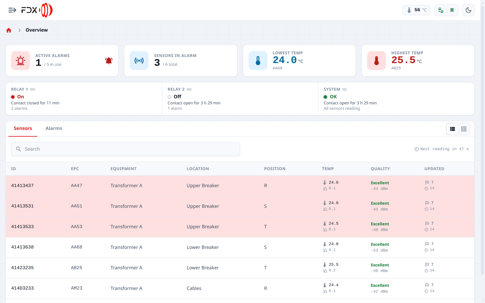
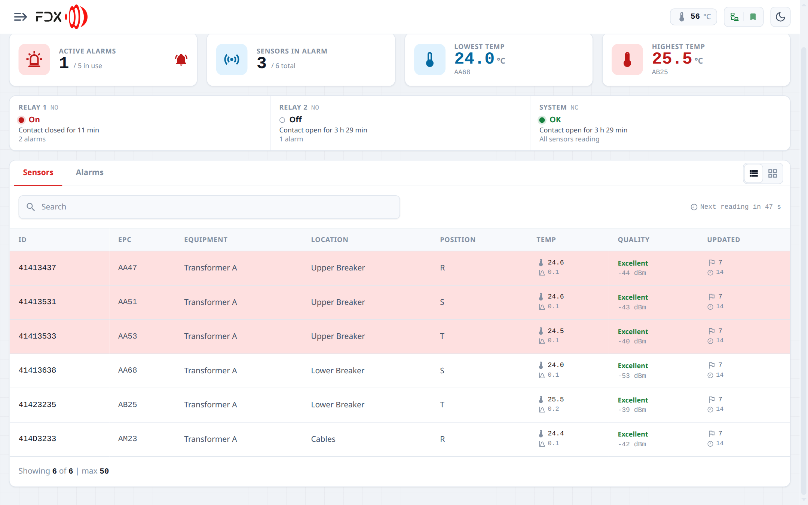
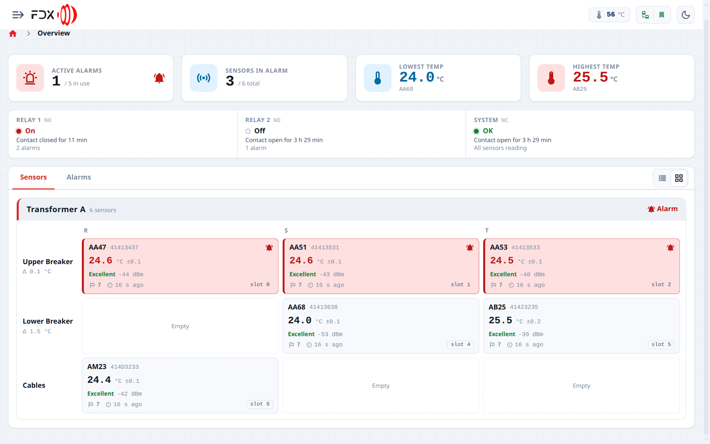
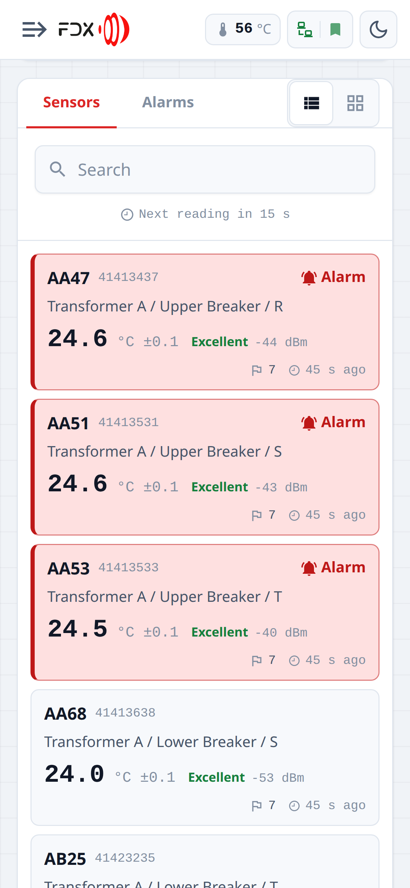
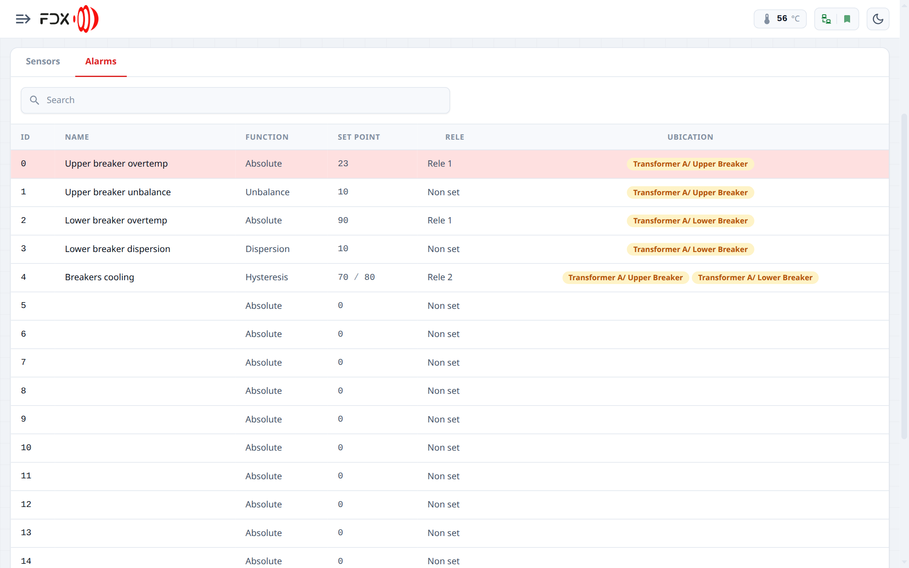

# Overview

| | |
|---|---|
| **Route** | `/` (home) |
| **Menu** | **Overview** |

The Overview is the main monitoring screen. Every value updates live; you do not need to reload
the page.

## Summary cards

| Card | Shows |
|------|-------|
| **Active alarms** | Alarms triggered right now, out of the alarms **in use** (alarms with a function and at least one location). A bell appears while any alarm is active. |
| **Sensors in alarm** | Sensors that are causing an active alarm, out of all configured sensors. |
| **Lowest temp** | The lowest temperature among the configured sensors, with the sensor name. |
| **Highest temp** | The highest temperature among the configured sensors, with the sensor name. |

A sensor that stops reporting keeps its last real temperature in **Lowest temp** and
**Highest temp**, so an overheating sensor that loses signal does not disappear from the summary.
Sensors that never reported a value are not counted.

## Relay panel

The HS has three output relays. The panel shows each one with a status lamp:

| Relay | Contact | Behavior |
|-------|---------|----------|
| **Relay 1** | NO (normally open) | **On** while any alarm assigned to Relay 1 is active. |
| **Relay 2** | NO (normally open) | **On** while any alarm assigned to Relay 2 is active. |
| **System** | NC (normally closed) | **OK** while the reader works and every configured sensor is reading. **Fault** otherwise. |

Under each relay you can read:

- the physical contact state and how long it has held, for example **Contact closed for 12 min**;
- for Relays 1 and 2, how many alarms drive it (**2 alarms**, **No alarms**);
- for the System relay in **Fault**, the reason, in the order you should check it:

| Reason | Meaning |
|--------|---------|
| **Reader offline** | The RFID reader does not respond. |
| **No antenna** | The reader found no connected antenna. |
| **Reader fault** | The reader state is unknown. |
| **No sensor reading** | None of the configured sensors is reporting. |
| **N sensors down** | N configured sensors are out of service. |
| **Cabinet incomplete** | Auto mode only: an antenna has no complete sensor group. |
| **Check sensors** | Other sensor problem. |

**Waiting** means the relay has not been driven yet since the unit started.

## Active groups (Auto mode only)

This card appears only when the unit runs in **Auto mode**. Each antenna shows the
EPC group of sensors currently locked to it. While a new group is being detected, the card shows
the candidate groups and their votes, for example `A4·5  B2·1`.

- **Set &lt;group&gt;**: locks the leading candidate right away instead of waiting for the
  detection window to finish. A later detection window can still change it.
- **Fast detection**: speeds up group detection for 3 minutes, useful during commissioning. A
  countdown and a **Stop** button are shown while it runs; it turns itself off when the time ends.

A tag may not appear if its EPC could not be decoded correctly.

## Sensors tab

Two views are available, selected with the buttons at the top right of the tab. Your browser
remembers the last one you used.

**List view**

| Column | Content |
|--------|---------|
| **ID** | Internal identifier of the sensor. |
| **EPC** | Sensor name (decoded from the tag EPC). |
| **Equipment**, **Location**, **Position** | Where the sensor is installed (see [Labels](labels.md)). |
| **Temp** | Average temperature of the last measurement window and its standard deviation. |
| **Quality** | Read quality (see [Reference](../99-reference.md#read-quality)) and the signal level in dBm. |
| **Updated** | Number of readings in the last window and seconds since the last valid temperature. |

- Rows of sensors in alarm are highlighted in red.
- Type in **Search** to filter by any visible text (name, ID, labels).
- **Next reading in N s** shows the time left until the next measurement.

**Map view**

The map draws one block per equipment, with locations as rows and positions as columns, so the
layout matches the physical equipment. Each cell shows the sensor name, temperature, quality,
number of readings, age of the last valid temperature and its Modbus slot. Next to each location,
**Δ N °C** is the difference between its hottest and coolest sensor, a quick way to spot a
point running hotter than the others.

Cells marked **Empty** have no sensor. A block with an active alarm shows an **Alarm** flag.
Sensors whose location or position has no label are only shown in the list view.

On phones the list view shows one card per sensor instead of a table.

## Alarms tab

A read-only list of the alarms (see [Alarms](alarms.md) for the columns). Active alarms are
highlighted in red. Click an alarm to expand the sensors it watches with their live values; click
it again to collapse.

