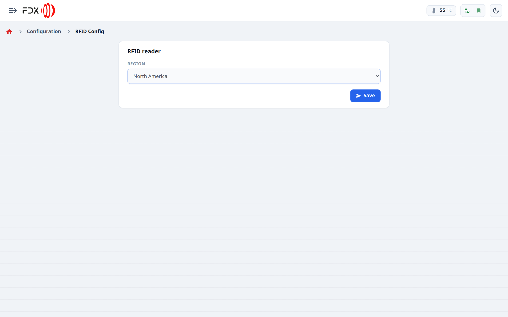

# RFID Config

| | |
|---|---|
| **Route** | `/configuration/readerConfig` |
| **Menu** | **Configuration > RFID Config** |

Settings of the RFID reader that talks to the sensors.

## Antenna detection

Scans the reader for connected antennas. Use it after connecting or moving an antenna cable.

1. Press **Detect antennas**.
2. The result lists each port with an antenna (**P1**, **P2**, ...). **No antennas detected**
   means the reader answered but found none: check the cables and scan again.

## Reader settings

| Field | Values | Description |
|-------|--------|-------------|
| **Region** | North America, Europe | Radio frequency band allowed in your country. Select the region where the unit is installed. |

Press **Save** to apply.
