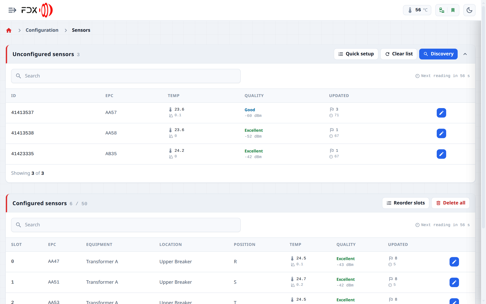
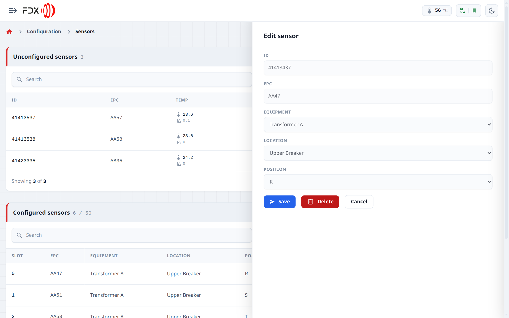
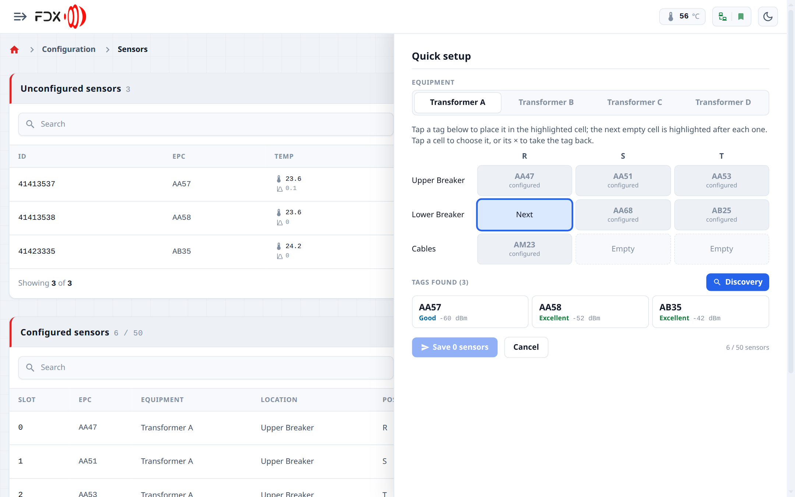

# Sensors

| | |
|---|---|
| **Route** | `/configuration/sensors` |
| **Menu** | **Configuration > Sensors** |

Registers the RFID temperature sensors and gives each one its place. A sensor is **configured**
when it has an equipment, a location and a position; only configured sensors are monitored,
trigger alarms and are published over Modbus. The unit accepts up to **50** configured sensors.

Set up the names in [Labels](labels.md) first.

## Unconfigured sensors

Tags read by the antennas that are not configured yet. The number next to the title is how many
there are; the arrow button collapses or expands the list.

| Button | Action |
|--------|--------|
| **Discovery** | Starts listening for every tag in range of the antennas. New tags appear in the list as they are read. While it runs the button becomes **Stop discovery**. |
| **Quick setup** | Opens the bulk placement panel (see below). |
| **Clear list** | Empties the list of unconfigured tags. Tags still in range appear again on the next discovery. |

During discovery the list shows the signal level of each tag as bars instead of the read quality
(see [Reference](../99-reference.md#signal-level-during-discovery)). Discovery stops when you leave
the view.

## Configuring one sensor

1. Press **Discovery** and wait for the tag to appear.
2. Click its row (or its card on a phone). The **Edit sensor** panel opens on the right.
3. Choose its **Equipment**, **Location** and **Position**. The **id** and **epc** fields are read only.
4. Press **Save**. The sensor moves to **Configured sensors**.

The panel warns you when:

- the 50 sensor limit is reached: delete a sensor before adding another one;
- another sensor already has the same equipment, location and position: saving overwrites that
  place.

## Quick setup

Places many tags at once on a grid of locations (rows) and positions (columns).

1. Press **Quick setup**.
2. Pick the **Equipment** at the top.
3. The highlighted cell (**Next**) is where the next tag goes. Tap a tag under **Tags found** to
   place it there; the next empty cell is highlighted automatically. Tap any empty cell to choose
   it instead. On a computer you can also drag a tag onto a cell.
4. To take a tag back, press the **×** of its cell.
5. Switch equipment to keep placing; a green counter on each equipment shows the tags placed but
   not saved yet.
6. Press **Save N sensors** to store all placements at once, or **Cancel** to drop them.

Cells marked **configured** already hold a sensor and cannot be used. If **Tags found** is empty,
press **Discovery** inside the panel. The counter at the bottom shows the total against the
50 sensor limit.

## Configured sensors

The list of monitored sensors, ordered by Modbus **Slot**, with the same live values as the [Overview](overview.md). The slot is the position of the sensor
in the Modbus register map (see [Modbus](modbus.md)).

| Action | How |
|--------|-----|
| Edit a sensor | Click its row or the edit button. Change the place and press **Save**. |
| Delete a sensor | Open it and press **Delete** in the edit panel. The sensor stops being monitored and its slot is freed. |
| **Reorder slots** | Renumbers the slots of every configured sensor, ordered by equipment, location and position, and closes the gaps. Run it once after the installation is complete. **It changes the Modbus address of the sensors**: the SCADA or master must be updated. |
| **Delete all** | Deletes every configured sensor after a confirmation. Tags still in range appear again as unconfigured. |

A sensor keeps its slot, so adding or deleting sensors later does not move the others. Deleting
sensors leaves gaps in the slot numbers until you run **Reorder slots**.
