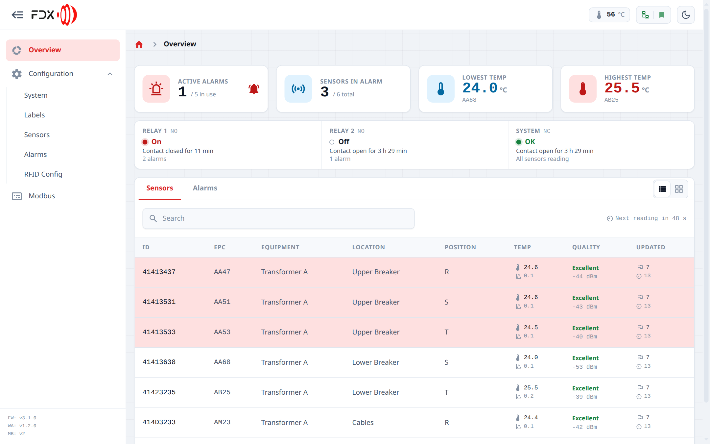

# Application shell

| | |
|---|---|
| **Route** | Present on every view |

The shell is the frame around every view: the top bar, the side menu, the breadcrumb, the reader
banner and the notifications.

## Top bar

From left to right:

| Element | Description |
|---------|-------------|
| Menu button | Opens and closes the side menu. |
| FDX logo | Reloads the application and returns to the **Overview**. |
| Board temperature | Internal temperature of the HS, in °C. |
| Connection indicator | Green: the page is receiving live data. Red: the connection was lost; the page keeps retrying on its own. |
| Mode indicator | The current operating mode of the unit (see below). Hover it to read its name. |
| Theme button | Switches between the light and the dark theme (see [Light and dark theme](../00-introduction.md#light-and-dark-theme)). The choice is remembered by your browser. |

## Mode indicator

| Icon | Mode | Meaning |
|------|------|---------|
| Bookmark | **Manual mode** | Normal operation. Only registered sensors are processed. |
| Cabinet | **Auto mode** | Sensor groups are registered automatically per antenna. |
| Magnifier | **Discovery mode** | Every tag in range is listed, to register new sensors. Started from [Sensors](sensors.md). |

## Side menu

| Entry | View |
|-------|------|
| **Overview** | [Overview](overview.md) |
| **Configuration > System** | [System](system.md) |
| **Configuration > Labels** | [Labels](labels.md) |
| **Configuration > Sensors** | [Sensors](sensors.md) |
| **Configuration > Alarms** | [Alarms](alarms.md) |
| **Configuration > RFID Config** | [RFID Config](rfid-config.md) |
| **Modbus** | [Modbus](modbus.md) |

The bottom of the menu shows the versions of the unit. Quote them when you contact support:

| Line | Meaning |
|------|---------|
| **FW** | Firmware version of the HS. |
| **WA** | Version of the web application. |
| **MB** | Version of the Modbus register map (contract). |

On phones, tablets and narrow windows the menu opens over the page and closes after you pick
an entry.

## Breadcrumb

Under the top bar, the breadcrumb shows where you are, for example
**Configuration > Sensors**. The house icon returns to the Overview.

## Reader banner

This banner can appear at the top of any view:

| Banner | Meaning | What to do |
|--------|---------|------------|
| Red reader banner: "The reader is not responding", "No antennas detected" or "Antenna state unknown" | The RFID reader is not working and the unit is not measuring. | Check the antenna cables. The HS retries the detection on its own; if the banner does not clear, contact support. |

## Notifications

Results of your actions appear as small messages at the bottom right corner:

- **green**: the action succeeded;
- **amber**: the action ran but the result needs your attention (for example no antennas found);
- **red**: the action failed, for example because the connection was lost or a value was rejected by the device.

Close a message with its **×**.

## Unsaved changes

Views with a form (System, Labels, RFID Config) warn you if you try to leave with changes that
are not saved yet. Choose to stay and save, or leave and discard them.
