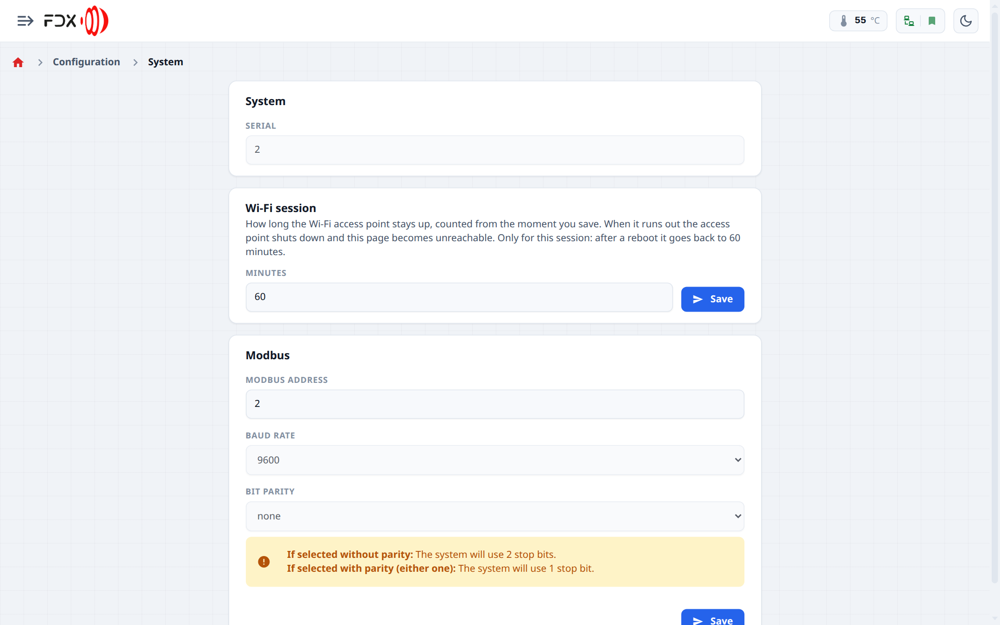

# System

| | |
|---|---|
| **Route** | `/configuration/system` |
| **Menu** | **Configuration > System** |

General settings of the unit.

## System card

Shows the **Serial** number of the unit (read only).

## Wi-Fi session

Sets how long the Wi-Fi access point stays on, counted from the moment you press **Save**.

| Field | Range | Notes |
|-------|-------|-------|
| **Minutes** | 1 to 1440 | Applies to the current session only. After a restart the unit goes back to 60 minutes. |

When the time runs out the access point turns off and the page can no longer be reached. Press
the Wi-Fi button of the HS again to reconnect.

## Modbus

Settings of the Modbus RTU (RS-485) link to the SCADA or master system. They must match the
master configuration.

| Field | Values |
|-------|--------|
| **Modbus address** | 1 to 247 |
| **Baud rate** | 9600, 19200, 38400, 57600, 115200 |
| **Bit parity** | none, odd, even |

The number of stop bits follows the parity: **none** uses 2 stop bits; **odd** or **even** use
1 stop bit. Press **Save** to apply.
