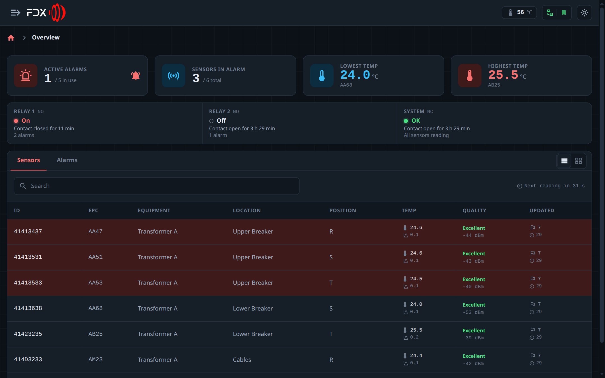
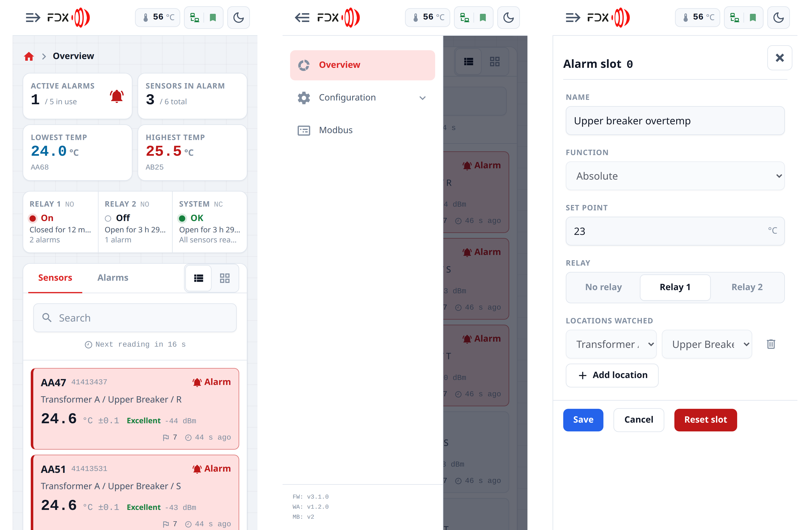

# Introducción {#introduction}

## Acerca de este manual {#about-this-manual}

Este manual describe la aplicación web integrada en el FDX-HS-CM, al que este manual llama
el HS: cómo acceder a ella y cómo utilizar cada una de sus vistas. La instalación, el cableado y
las especificaciones técnicas del equipo se tratan en el Manual de Usuario del FDX-HS-CM
(FDX-HS-UM-002); la puesta en marcha inicial se resume en la Guía Rápida (FDX-HS-UM-001).

> **NOTE:** Las capturas de pantalla son solo de referencia. La interfaz se mejora continuamente y
> puede diferir levemente de la de su equipo.

## Acerca del FDX-HS-CM {#about-the-fdx-hs-cm}

El FDX-HS-CM es un sistema de monitoreo de puntos calientes. Los sensores de temperatura RFID,
inalámbricos y sin batería, se instalan sobre los puntos a supervisar. El HS los lee a
través de sus antenas, evalúa las alarmas configuradas, acciona sus relés de salida y publica
cada valor por Modbus RTU hacia un sistema SCADA o maestro.

El HS cuenta con una aplicación web integrada, que se utiliza para:

- observar en tiempo real las temperaturas, las alarmas y el estado de los relés;
- registrar sensores y asignar a cada uno su lugar (equipo, ubicación y posición);
- configurar las alarmas y los relés que estas accionan;
- configurar el enlace Modbus y el lector RFID.

La aplicación web no requiere instalar software en su computadora: funciona con cualquier
navegador moderno (Chromium, Chrome, Firefox, Edge, Safari), en una computadora de escritorio, una
tablet o un teléfono.

## Conexión al equipo {#connecting-to-the-device}

El HS publica su propio punto de acceso Wi-Fi. El punto de acceso permanece apagado durante la
operación normal.

1. Mantenga presionado el botón Wi-Fi del HS hasta que se encienda el LED azul marcado como
   **WIFI** en la carcasa (unos **5 segundos**). Con el LED encendido, el punto de acceso y la
   aplicación web están disponibles.
2. En su computadora o teléfono, conéctese a la red Wi-Fi **`fdx-hs-<serial>`**, donde
   `<serial>` es el número de serie del equipo. Utilice la contraseña Wi-Fi provista por FDX.
3. Abra un navegador e ingrese a **`http://192.168.10.1`**.

El punto de acceso se apaga automáticamente después de **60 minutos**. Puede modificar este tiempo
para la sesión actual en [System > Wi-Fi session](components/system.md#wi-fi-session). Cuando el
punto de acceso se apaga, la página deja de actualizarse; presione nuevamente el botón para
volver a conectarse.

### Tema claro y tema oscuro {#light-and-dark-theme}

La aplicación web dispone de un tema claro y un tema oscuro. Puede alternar entre ellos en
cualquier momento con el botón de tema ubicado en el extremo derecho de la barra superior (ícono
de luna o de sol). Su navegador recuerda la elección. Las capturas de pantalla de este manual
utilizan el tema claro.

### Teléfonos y tablets {#phones-and-tablets}

La aplicación web se adapta a la pantalla en la que se abre, por lo que las mismas funciones están
disponibles en una computadora, una tablet o un teléfono:

- el menú lateral se abre sobre la página con el botón de menú y se cierra al elegir una entrada;
- las tablas se convierten en una tarjeta por sensor o por alarma, con el nombre y la lectura
  primero;
- los paneles de edición ocupan toda la pantalla, con sus botones fijos en la parte inferior;
- los botones y las entradas de las listas se agrandan para facilitar el toque.

Los teléfonos funcionan en orientación vertical y horizontal. Las capturas de pantalla de este
manual se tomaron en una computadora; en un teléfono el contenido y los botones son los mismos,
solo que dispuestos de otra manera.

## Primeros pasos: puesta en servicio de un equipo nuevo {#getting-started-commissioning-a-new-unit}

El orden habitual para poner en servicio un HS nuevo:

1. **Conéctese** al equipo (ver arriba).
2. **[System](components/system.md)**: configure la dirección Modbus, la velocidad (baud rate) y la
   paridad de su enlace SCADA.
3. **[RFID Config](components/rfid-config.md)**: seleccione la región de radio de su país.
4. **[Labels](components/labels.md)**: asigne nombres a sus equipos, ubicaciones y posiciones.
5. **[Sensors](components/sensors.md)**: ejecute el modo de descubrimiento y asigne a cada sensor
   su lugar, uno por uno o con **Quick setup** (configuración rápida).
6. **[Alarms](components/alarms.md)**: cree las alarmas y elija el relé que acciona cada una.
7. **[Overview](components/overview.md)**: confirme que todos los sensores informan una
   temperatura y que el relé **System** indica **OK**.
8. **[Modbus](components/modbus.md)**: entregue el mapa de registros al integrador SCADA.
