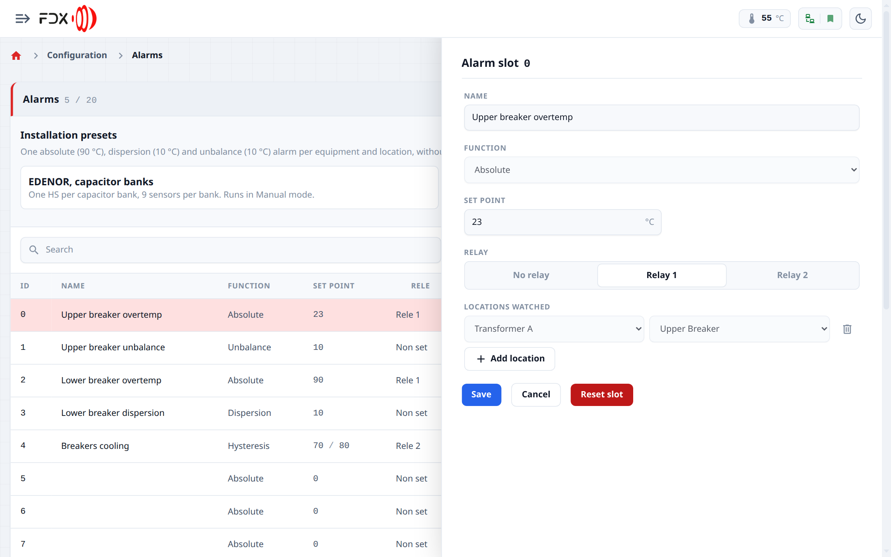

# Alarms: presets de instalación {#alarms-installation-presets}

| | |
|---|---|
| **Vista** | [Alarms](../components/alarms.md) |

## Presets de instalación {#installation-presets}

Muestre los presets con el gesto sobre el título **Alarms** (**Ctrl + Shift** y **doble clic** en
una computadora, **mantener presionado** en una pantalla táctil).

Un preset escribe un conjunto estándar de alarmas para una instalación típica: una alarma
**Absolute** (90 °C), una **Dispersion** (10 °C) y una **Unbalance** (10 °C) por equipo y
ubicación, sin relé. Algunos presets preguntan qué banco supervisa la unidad.

1. Cargue y guarde primero el preset correspondiente en [Labels](labels.md). El preset utiliza los
   nombres de las etiquetas e indica cualquier nombre que falte en el equipo.
2. Elija el preset. El panel muestra una vista previa de las alarmas y los slots que ocupan.
3. Presione **Apply preset** y confirme. Los slots listados se sobrescriben y **todos los demás
   slots se borran**.
4. Revise las alarmas y asigne relés donde sea necesario.
