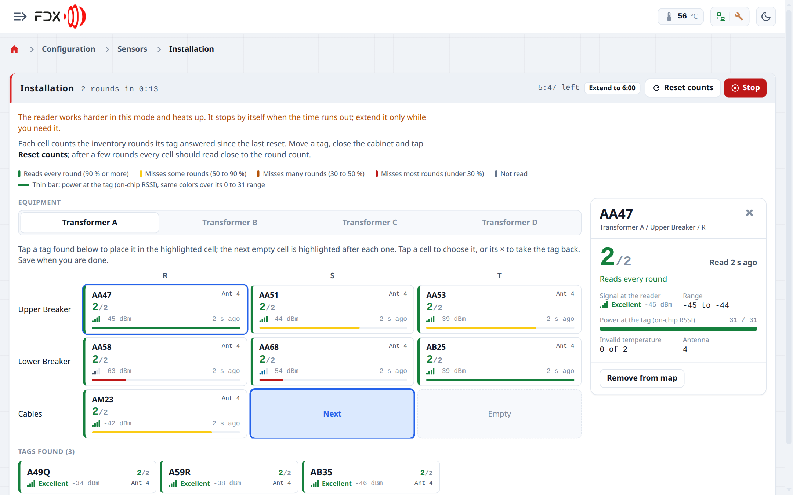

# Installation {#installation}

| | |
|---|---|
| **Ruta** | `/configuration/installation` |
| **Menú** | Ninguno. Se abre desde [Sensors](../components/sensors.md) con el gesto de administrador sobre el título **Unconfigured sensors**. |

Una herramienta de campo para verificar que cada sensor se lea de forma confiable en su posición
final, y para ubicar tags nuevos en el mapa de equipos mientras trabaja sobre el equipo.

Mientras la herramienta está en ejecución, el lector RFID lee en forma continua con los tiempos de
producción y cuenta, para cada tag, en cuántas **rondas** de inventario respondió. Un sensor en una
buena posición responde en casi todas las rondas.

> **NOTE:** La operación normal queda en pausa. La medición, las alarmas, los relés y Modbus se
> detienen mientras esta herramienta está abierta y se reanudan al salir de ella. El lector RFID
> trabaja más intensamente en este modo y se calienta, por lo que una sesión finaliza por sí sola
> después de **6 minutos** a menos que usted la extienda.

## Inicio y detención {#starting-and-stopping}

1. Abra la herramienta desde [Sensors](../components/sensors.md). Confirme el diálogo para iniciar.
2. El encabezado muestra **N rounds in mm:ss** (desde el inicio o el último reinicio de conteos) y
   el tiempo restante.
3. **Extend to 6:00** restablece el tiempo restante a 6 minutos. Extienda solo mientras lo necesite.
4. **Stop** finaliza la sesión y vuelve a Sensors.

Cuando la sesión finaliza por tiempo, o se detiene desde otro navegador, la vista lo indica y
ofrece **Start again**. Mientras una sesión está en ejecución, el indicador de modo de la barra
superior muestra una llave y todas las demás vistas muestran el aviso **Installation mode is on**,
con los botones **Open** (volver a la herramienta) y **Stop** (finalizar la sesión).

## Lectura del mapa {#reading-the-map}

Elija el **Equipment** (equipo) en la parte superior. El mapa muestra las ubicaciones como filas y
las posiciones como columnas.

Cada celda de sensor configurado muestra:

| Elemento | Significado |
|---------|---------|
| **reads/rounds** (por ejemplo `48/50`) | Rondas en las que respondió el tag sobre el total de rondas ejecutadas. Coloreado según la escala siguiente. |
| Color del borde izquierdo | La misma escala, visible de un vistazo. |
| **Ant N** | Antena de la última lectura. |
| Ícono de advertencia y número | Lecturas con una temperatura no utilizable. |
| Barras de señal | Nivel de señal en el lector. |
| Tiempo | Tiempo transcurrido desde la última lectura. |
| Barra delgada | Potencia recibida por el tag (RSSI en el chip), con los mismos colores en su rango de 0 a 31. |
| **Check tag** | El tag recibe potencia suficiente pero con frecuencia devuelve una temperatura inválida. Puede estar defectuoso. |

Escala de colores (proporción de rondas respondidas):

| Color | Etiqueta | Proporción |
|-------|-------|-------|
| Verde | **Reads every round** | 90 % o más |
| Amarillo | **Misses some rounds** | 50 a 90 % |
| Naranja | **Misses many rounds** | 30 a 50 % |
| Rojo | **Misses most rounds** | Menos de 30 % |
| Gris | **Not read** | Sin lecturas desde el último reinicio de conteos |

Un contador rojo sobre el botón de un equipo indica cuántos de sus sensores no responden en la
mayoría de las rondas o no se leen, de modo que no se pasen por alto problemas en otro equipo.

## Verificación de la posición de un sensor {#checking-a-sensor-position}

1. Mueva o fije el tag y cierre el gabinete.
2. Presione **Reset counts**.
3. Después de algunas rondas, cada celda debería indicar un valor cercano al número de rondas.

Haga clic en una celda de sensor para abrir el panel **finder** (búsqueda), con texto grande legible
a la distancia de un brazo:

| Campo | Significado |
|-------|---------|
| **reads/rounds** y **Read now** / **Read N s ago** | Conteo de lecturas en vivo. **Read now** aparece cuando el tag se leyó en el último segundo. |
| **Signal at the reader** y **Range** | Señal actual y sus valores mínimo y máximo desde el reinicio de conteos. |
| **Power at the tag** | RSSI en el chip, sobre 31. |
| **Invalid temperature** | Lecturas con una temperatura no utilizable. |
| **Antenna** | Antena de la última lectura. |

Si el sensor no se leyó desde el reinicio de conteos, verifique que el tag esté orientado hacia una
antena y que ningún elemento metálico lo cubra. **Remove from map** elimina el sensor de la
configuración; el tag permanece en la lista de tags encontrados.

## Ubicación de tags nuevos {#placing-new-tags}

**Tags found** lista los tags leídos durante la sesión que aún no están configurados, con su
conteo de lecturas, señal y antena. La ubicación funciona como en [Quick setup](../components/sensors.md#quick-setup):

1. La celda resaltada (**Next**) recibe el siguiente tag. Toque un tag para ubicarlo allí; toque
   una celda para elegir otra.
2. Los tags ubicados muestran **not saved**; presione **×** para retirar uno.
3. Presione **Save N sensors** para guardar todas las ubicaciones, o **Discard** para descartarlas.

Si sale de la vista o presiona **Stop** con ubicaciones sin guardar, primero se solicita confirmación.
