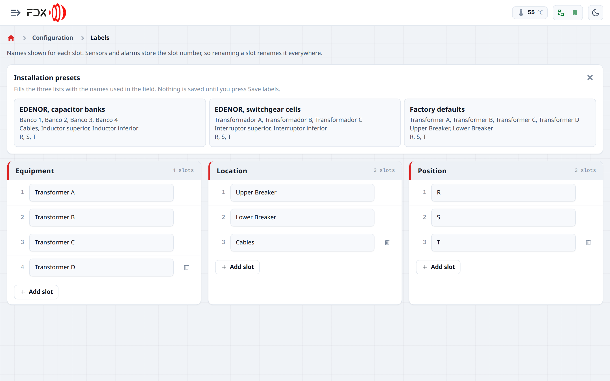

# Labels: presets de instalación {#labels-installation-presets}

| | |
|---|---|
| **Vista** | [Labels](../components/labels.md) |

## Presets de instalación {#installation-presets}

Muestre los presets con el gesto sobre el texto descriptivo de la parte superior de la vista
(**Ctrl + Shift** y **doble clic** en una computadora, **mantener presionado** en una pantalla táctil).

Un preset completa las tres listas con los nombres de una instalación típica. Cada tarjeta de
preset muestra los nombres que carga. **Factory defaults** restaura los nombres en inglés con los
que se entrega el equipo; los demás presets corresponden a instalaciones estándar preparadas por FDX.

Cargar un preset solo completa el formulario: revise los nombres y presione **Save labels** para
guardarlos. Cargue aquí el mismo preset antes de aplicar el preset de alarmas correspondiente en
[Alarms](alarms.md).
