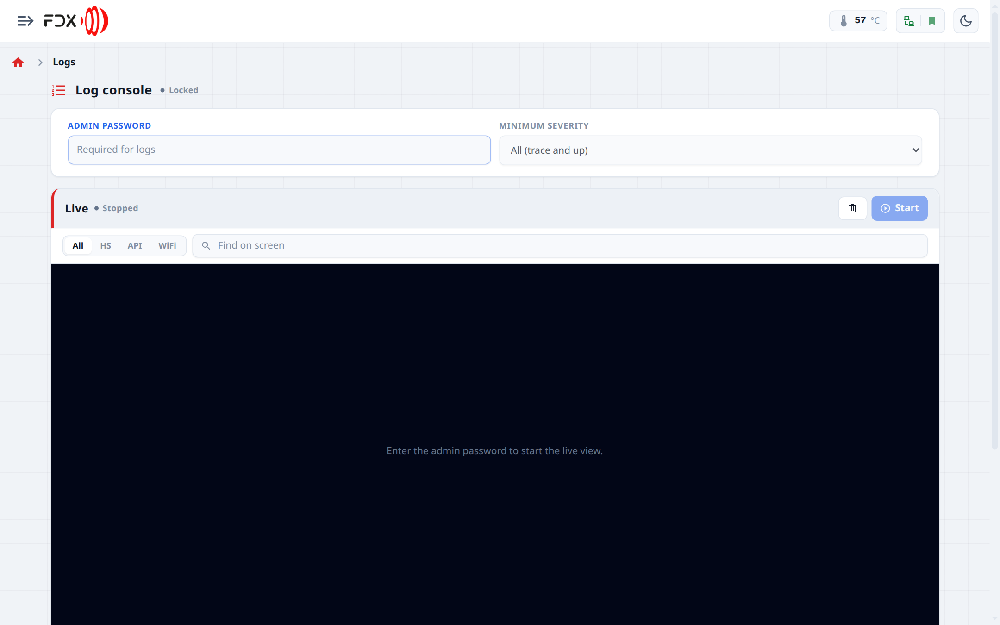

# Logs {#logs}

| | |
|---|---|
| **Ruta** | `/admin/logs` |
| **Menú** | Ninguno. Aplique el gesto de administrador sobre el bloque de versión (FW / WA / MB) en la parte inferior del menú lateral. |

La consola de logs muestra en vivo lo que están haciendo los servicios de la unidad, y descarga
archivos de log para enviar al soporte de FDX.

## Desbloqueo {#unlocking}

| Campo | Descripción |
|-------|-------------|
| **Admin password** | Necesaria para todas las funciones de esta vista. El estado en la parte superior cambia de **Locked** a **Unlocked** una vez ingresada. Una contraseña incorrecta se informa al iniciar la vista en vivo o una descarga. |
| **Minimum severity** | Severidad mínima mostrada y descargada: **All (trace and up)**, **Debug and up**, **Info and up**, **Warning and up**, **Errors only**. |

## En vivo {#live}

| Control | Acción |
|---------|--------|
| **Start** / **Stop** | Inicia o detiene el seguimiento de los logs de todos los servicios. |
| **Pause** / **Resume** | Congela la pantalla sin detener el flujo. |
| Botón de borrado | Borra la pantalla. |
| Botones de servicio | Muestran todos los servicios o solo uno. |
| **Find on screen** | Resalta las líneas que contienen el texto. |

Cada línea muestra la hora, la severidad, el servicio, el módulo y el mensaje. La pantalla conserva
las últimas 2000 entradas; descargue el log para obtener el historial completo. Al desplazarse hacia
arriba, las líneas nuevas siguen llegando y un botón **jump to latest** indica cuántas no ha visto.

## Descarga {#download}

| Campo | Valores |
|-------|--------|
| **Source** | Todos los servicios combinados por hora, aplicación principal del HS, servicio API RFID, servicio WiFi |
| **Time range** | Últimos 5, 15 o 30 minutos, última hora, últimas 2 horas, log actual completo |

Presione **Download log**. El archivo utiliza la **Minimum severity** seleccionada arriba y conserva
el formato original del log. Las horas se miden con el reloj del equipo.

## Nivel en tiempo de ejecución {#runtime-level}

Plegado por defecto. Modifica el nivel de detalle que cada servicio escribe en su log:

| Destino | Servicio |
|--------|---------|
| **HS main application** | Aplicación de monitoreo |
| **RFID API service (app)** | Servicio del lector RFID |
| **RFID API reader (driver)** | Driver de bajo nivel del lector RFID |

Elija un nivel de log (**trace**, **debug**, **info**, **warning**, **error**) y presione **Apply**.
El nivel se aplica hasta que el servicio se reinicia, y luego vuelve a su valor por defecto. Utilice
niveles detallados solo mientras investiga un problema, ya que generan logs mucho más grandes.
