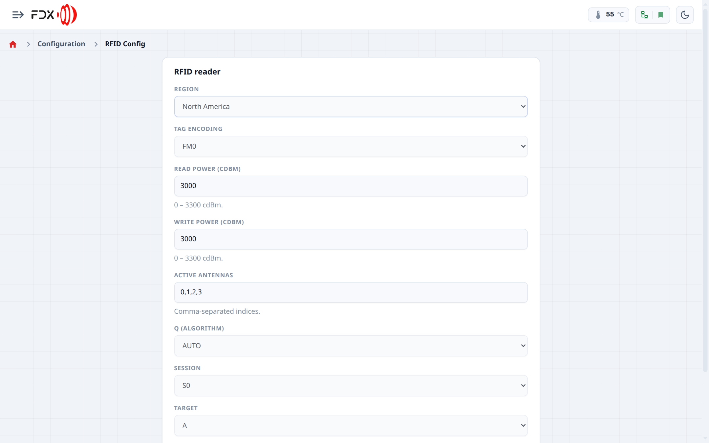

# RFID Config: configuración avanzada {#rfid-config-advanced-settings}

| | |
|---|---|
| **Vista** | [RFID Config](../components/rfid-config.md) |

Muestre la configuración avanzada con el gesto sobre el título **RFID reader** (**Ctrl + Shift** y
**doble clic** en una computadora, **mantener presionado** en una pantalla táctil).

| Campo | Valores | Descripción |
|-------|--------|-------------|
| **Tag Encoding** | FM0, Miller 2, Miller 4, Miller 8 | Codificación de las respuestas de los tags. |
| **Read power (cdBm)** | 0 a 3300 | Potencia de transmisión para lectura (potencia de lectura), en centésimas de dBm (3000 = 30 dBm). |
| **Write power (cdBm)** | 0 a 3300 | Potencia de transmisión para escritura (potencia de escritura), en centésimas de dBm. |
| **Active antennas** | Lista separada por comas, por ejemplo `0,1,2,3` | Puertos de antena utilizados por el lector RFID. |
| **Q (algorithm)** | AUTO, Q0 a Q15 | Parámetro anticolisión del inventario. |
| **Session** | S0 a S3 | Sesión de inventario del protocolo EPC Gen2. |
| **Target** | A, B | Objetivo de inventario del protocolo EPC Gen2. |
| **Password** | | Contraseña de administrador. Necesaria para guardar los campos avanzados. |

Botones:

| Botón | Acción |
|--------|--------|
| **Save** | Guarda la región y los campos avanzados. Con una contraseña incorrecta la página muestra **Wrong password: advanced fields were not updated**. |
| **Restore factory defaults** | Después de una confirmación, sobrescribe toda la configuración del lector RFID con los valores de fábrica. Requiere la contraseña. |
| **Cancel** | Oculta los campos avanzados y descarta sus cambios. |

Modificar estos valores afecta la confiabilidad con que se leen los sensores. Modifíquelos solo
siguiendo instrucciones de FDX, y verifique el resultado con la [herramienta Installation](installation.md).
