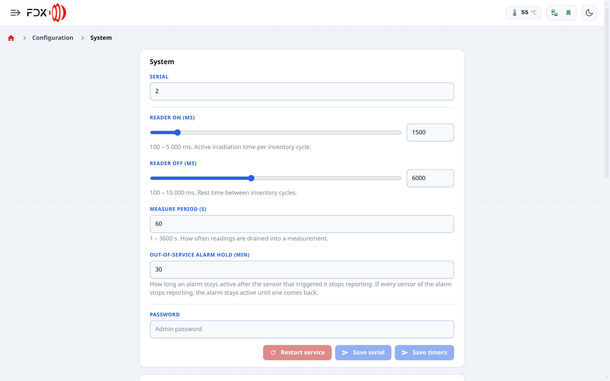
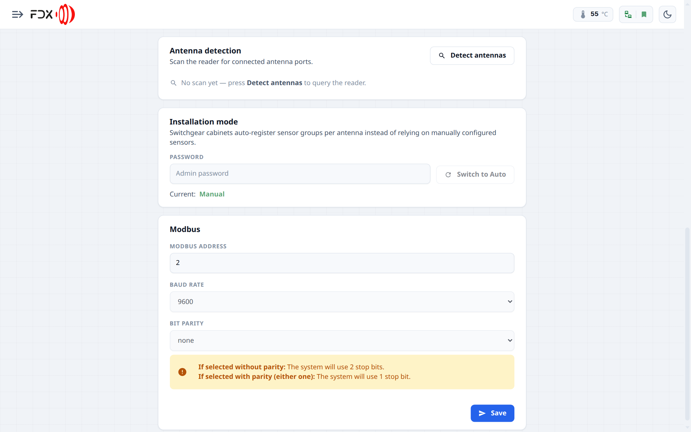

# System: configuración de servicio {#system-service-settings}

| | |
|---|---|
| **Vista** | [System](../components/system.md) |

Muestre los controles de administrador con el gesto sobre la tarjeta **System**: **Ctrl + Shift** y
**doble clic** en cualquier lugar de la tarjeta (computadora) o **mantener presionado** el título
**System** (táctil).

## Número de serie y tiempos de inventario {#serial-and-inventory-timers}

La tarjeta System muestra estos campos editables:

| Campo | Rango | Descripción |
|-------|-------|-------------|
| **Serial** | Hasta 8 caracteres | Número de serie de la unidad. También da nombre a la red Wi-Fi (`fdx-hs-<serial>`). |
| **Reader on (ms)** | 100 a 5000 | Tiempo durante el cual el lector RFID transmite en cada ciclo de inventario. |
| **Reader off (ms)** | 100 a 15000 | Tiempo de reposo entre ciclos de inventario. |
| **Measure period (s)** | 1 a 3600 | Frecuencia con la que las lecturas recolectadas se convierten en una nueva medición (temperaturas, alarmas, Modbus). |
| **Out-of-service alarm hold (min)** | Período de medición a 1092 | Tiempo durante el cual una alarma permanece activa después de que el sensor que la disparó deja de reportar. Si todos los sensores de la alarma dejan de reportar, la alarma permanece activa hasta que uno vuelva a reportar. |

Reglas verificadas en pantalla:

- El **Measure period** (período de medición) debe ser al menos **Reader on + Reader off** (un
  ciclo de inventario completo por medición). Si no se cumple, se muestra un mensaje en ámbar y
  **Save timers** permanece deshabilitado.
- Aparece una recomendación en azul cuando el período de medición es menor que **1,5 veces**
  (idealmente 2 veces) **Reader on + Reader off**. Se permite guardar, pero una ventana ajustada
  puede recolectar menos de dos lecturas y marcar sensores como fuera de servicio por error.

En la parte inferior de la tarjeta:

| Control | Acción |
|---------|--------|
| **Password** | Contraseña de administrador, utilizada por los tres botones siguientes. |
| **Restart service** | Reinicia la aplicación del HS después de una confirmación. La página se desconecta durante algunos segundos. |
| **Save serial** | Guarda el número de serie. |
| **Save timers** | Guarda los cuatro campos de tiempos. |

Con una contraseña incorrecta la página muestra **Wrong password** y no se modifica nada.

## Detección de antenas {#antenna-detection}

Explora el lector RFID en busca de antenas conectadas. No requiere contraseña.

1. Presione **Detect antennas**.
2. El resultado lista cada puerto con una antena (**P1**, **P2**, ...). **No antennas detected**
   significa que el lector RFID respondió pero no encontró ninguna: verifique los cables y vuelva
   a explorar.

## Modo de instalación (Manual / Auto) {#installation-mode-manual-auto}

Selecciona el modo de funcionamiento de la unidad. A pesar de su nombre, esta tarjeta no es la
[herramienta Installation](installation.md).

| Modo | Uso |
|------|-----|
| **Manual** | Instalaciones normales. Solo se procesan los sensores que usted registra en [Sensors](../components/sensors.md). |
| **Auto** | Los grupos de sensores se registran automáticamente por antena y se siguen a medida que cambian. |

**Current** muestra el modo activo. Para cambiarlo, ingrese la contraseña de administrador en el
campo **Password** propio de esta tarjeta y presione **Switch to Auto** o **Switch to Manual**. El
cambio se aplica de inmediato.
