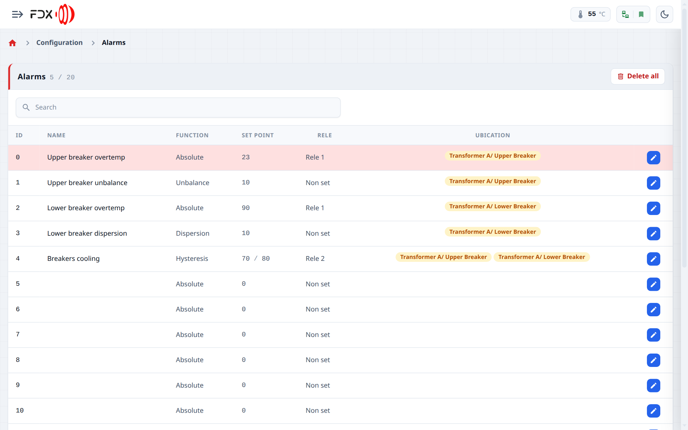
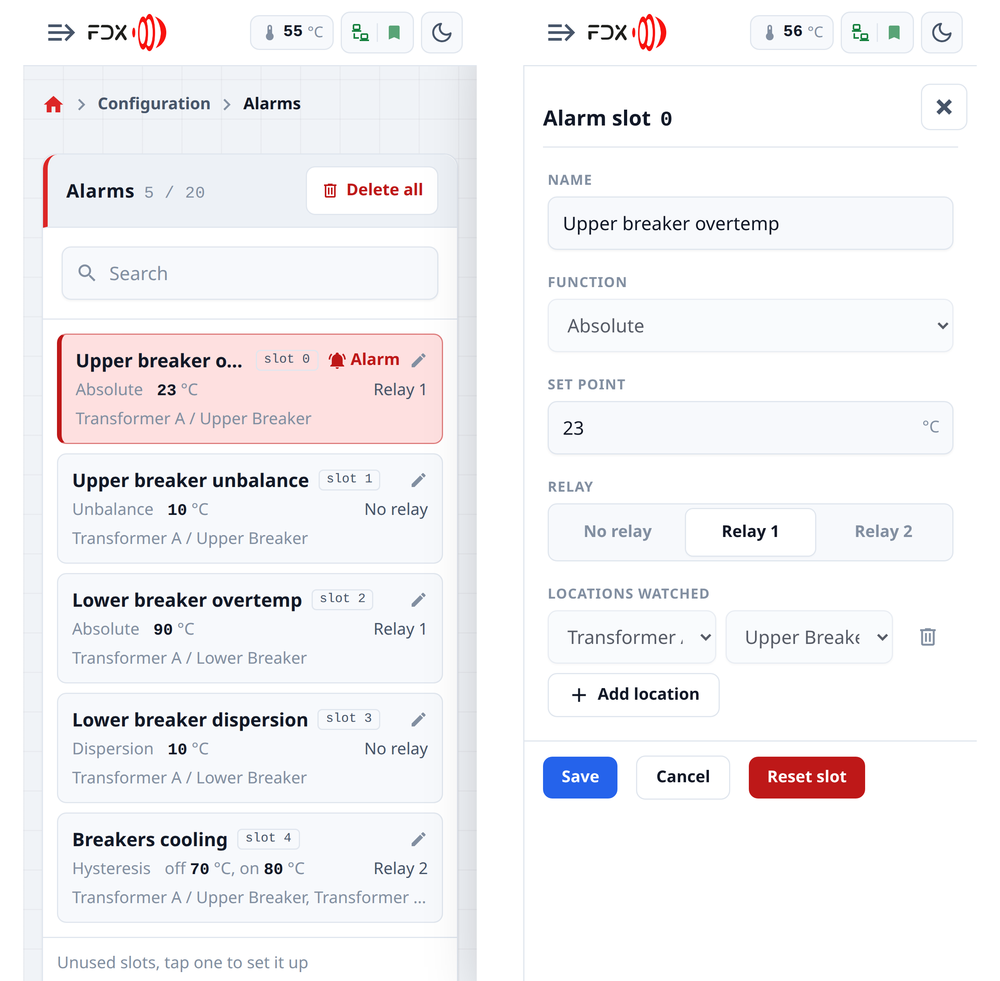
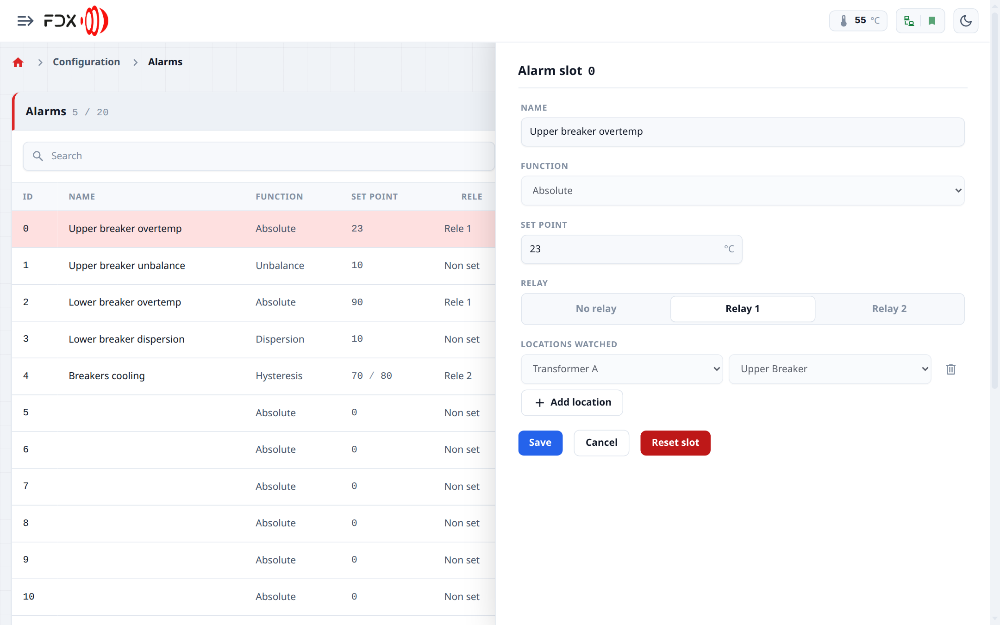

# Alarmas {#alarms}

| | |
|---|---|
| **Ruta** | `/configuration/alarms` |
| **Menú** | **Configuration > Alarms** |

El equipo tiene **20 slots de alarma** (0 a 19). Cada alarma vigila una o más ubicaciones de
equipo, aplica una función a las temperaturas de sus sensores y, al dispararse, puede accionar el
Relé 1 o el Relé 2. El número junto al título muestra los slots en uso sobre el total.

## Lista de alarmas {#alarm-list}

| Columna | Contenido |
|--------|---------|
| **Id** | Número de slot. |
| **Name** | Nombre de la alarma. |
| **Function** | Función de la alarma (ver más abajo). **Non set** significa que la alarma está desactivada. |
| **Set point** | Umbral en °C. Para alarmas de histéresis: umbrales `off / on`. |
| **Rele** | Relé accionado por la alarma: **Non set**, **Rele 1** o **Rele 2**. |
| **Ubication** | Pares de equipo y ubicación vigilados por la alarma. |

Las alarmas disparadas se resaltan en rojo. Use **Search** para filtrar por nombre, función o relé.
En los teléfonos, las alarmas en uso se muestran como tarjetas, con su función, punto de consigna,
relé y ubicaciones; una alarma activa tiene una tarjeta roja con un indicador **Alarm**. Los slots
sin uso se muestran como una tira de números debajo de las tarjetas: toque uno para configurarlo.
Al tocar una tarjeta, el editor se abre en pantalla completa.

**Delete all** borra todos los slots de alarma, previa confirmación; los relés dejan de ser
accionados por ellas.

## Edición de una alarma {#editing-an-alarm}

Haga clic en una alarma (o en un slot sin uso) para abrir el panel **Alarm slot**.

| Campo | Descripción |
|-------|-------------|
| **Name** | Obligatorio, por ejemplo "Upper section overtemp". |
| **Function** | **Not set (alarm off)**, **Absolute**, **Unbalance**, **Dispersion** o **Hysteresis**. |
| **Set point** | Umbral en °C, número entero de -40 a 120. |
| **Off below** / **On above** | Solo para histéresis, ver más abajo. |
| **Relay** | **No relay**, **Relay 1** o **Relay 2**. |
| **Locations watched** | Pares de equipo y ubicación. Todos los sensores de esas ubicaciones participan en la alarma. Presione **Add location** para agregar una fila y el botón de quitar para eliminarla. El mismo par no puede figurar dos veces. |

Una alarma sin ubicaciones no puede dispararse.

Botones:

- **Save**: guarda el slot. Se habilita cuando el nombre, los puntos de consigna y las ubicaciones son válidos.
- **Cancel**: cierra el panel sin guardar.
- **Reset slot**: vacía el slot.

## Funciones de alarma {#alarm-functions}

Todas las funciones ignoran los sensores fuera de servicio. Todas las temperaturas son los
promedios de la última ventana de medición.

| Función | Dispara un sensor cuando |
|----------|------------------------|
| **Absolute** | Su temperatura supera el punto de consigna. |
| **Unbalance** | Su temperatura difiere del promedio de los sensores vigilados en más que el punto de consigna (por encima o por debajo). |
| **Dispersion** | Su temperatura supera la del sensor vigilado más frío más el punto de consigna. |
| **Hysteresis** | La alarma se activa cuando un sensor supera **On above** y permanece activa hasta que todos los sensores vigilados bajan de **Off below**. Entre ambos valores mantiene su estado, lo que evita el accionamiento intermitente del relé alrededor de un único umbral. **Off below** debe ser menor que **On above**. |

Ejemplo: una alarma **Unbalance** con punto de consigna de 10 °C sobre una ubicación con tres
sensores se dispara cuando uno de ellos está 10 °C más caliente o más frío que el promedio de los tres.

Cuando un sensor que disparó una alarma deja de reportar, la alarma permanece activa durante un
tiempo de retención (30 minutos por defecto). Si todos los sensores de la alarma dejan de reportar,
la alarma permanece activa hasta que alguno de ellos vuelva, de modo que un sensor que se
sobrecalienta hasta perder la señal nunca borra su alarma por sí solo.
