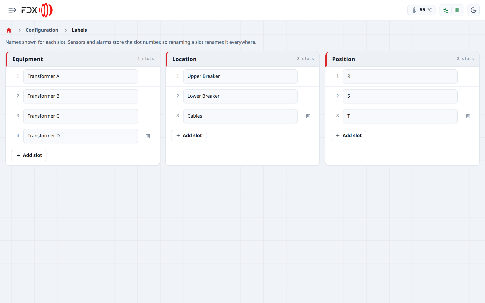

# Labels {#labels}

| | |
|---|---|
| **Ruta** | `/configuration/labels` |
| **Menú** | **Configuration > Labels** |

Las etiquetas son los nombres que se utilizan para describir dónde está instalado cada sensor. Hay
tres listas:

| Lista | Describe | Ejemplo |
|------|-----------|---------|
| **Equipment** | El equipo | Tablero 1, Máquina 2 |
| **Location** | Una parte del equipo | Sección superior, Sección inferior |
| **Position** | Un punto de esa parte | Izquierda, Centro, Derecha |

Cada nombre ocupa un **slot** numerado. Los sensores y las alarmas almacenan el número de slot, no
el nombre, por lo que al renombrar un slot el cambio se aplica en todas partes a la vez (Overview,
Sensors, Alarms).

En una pantalla ancha las tres listas se muestran una junto a otra; en pantallas angostas cada
lista es una pestaña.

| Acción | Cómo |
|--------|-----|
| Renombrar un slot | Escriba en su campo. Hasta 20 caracteres. Déjelo vacío para marcar el slot como no utilizado. |
| Agregar un slot | Presione **Add slot** debajo de la lista. |
| Eliminar un slot | Solo se puede eliminar el último slot de una lista, con el botón de eliminar de su fila. Los slots intermedios no se pueden eliminar porque los sensores y las alarmas los referencian por número; en su lugar, déjelos vacíos. |

No se puede usar el mismo nombre dos veces en una lista. Los nombres duplicados se resaltan con un
borde rojo y no se puede guardar hasta que se corrijan.

Mientras haya cambios por guardar, se muestra una barra fija en la parte inferior de la vista:

- **Save labels**: almacena los cambios en el equipo.
- **Discard**: vuelve a los nombres almacenados en el equipo.
