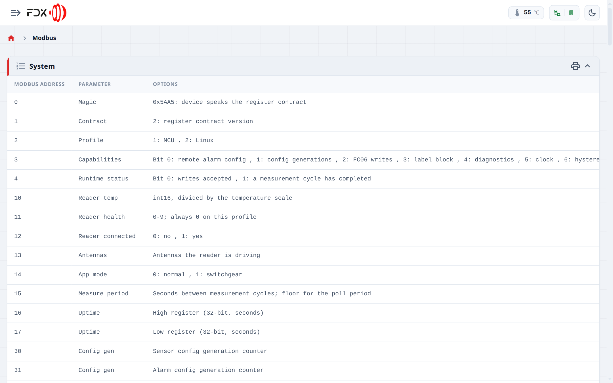

# Modbus {#modbus}

| | |
|---|---|
| **Ruta** | `/modbus` |
| **Menú** | **Modbus** |

Muestra el mapa de registros Modbus publicado por este equipo, como tablas informadas por el propio
dispositivo, de modo que siempre coincide con el firmware instalado. Entréguelo al integrador del
SCADA. La versión del mapa aparece como **MB** en la parte inferior del menú lateral.

Los parámetros de comunicación (dirección, velocidad en baudios, paridad) se configuran en
[System](system.md#modbus).

- Haga clic en el título de una tabla para contraerla o expandirla.
- El botón de impresora imprime la página (o la guarda como PDF desde el diálogo de impresión del navegador).

Las direcciones de registro de cada sensor dependen de su **Slot** de Modbus, que se muestra en
[Sensors](sensors.md#configured-sensors) y en la vista de mapa de [Overview](overview.md).
Ejecutar **Reorder slots** en Sensors cambia estas direcciones.
