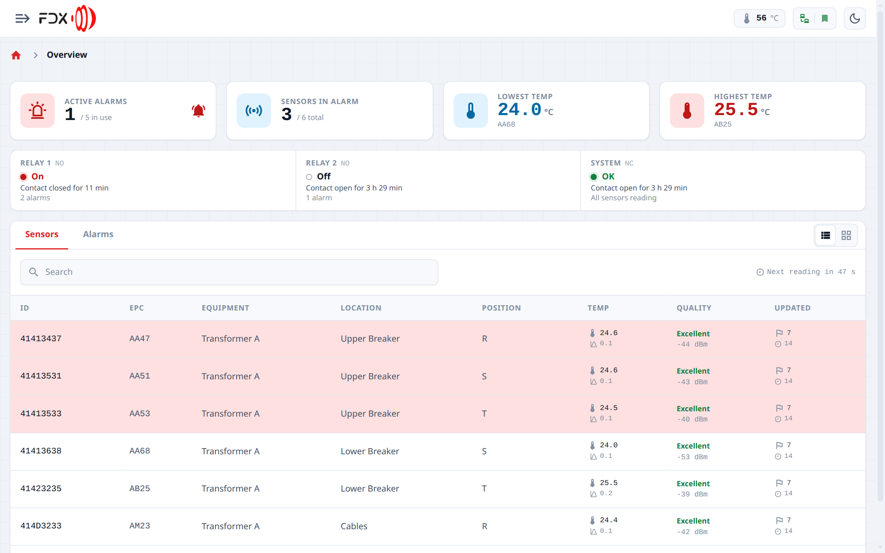
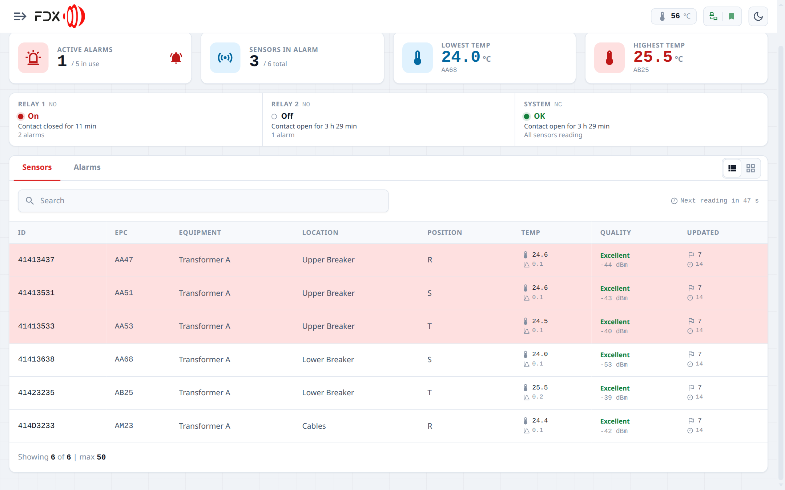
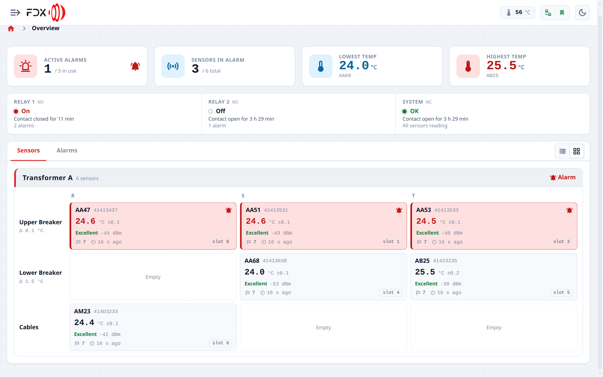
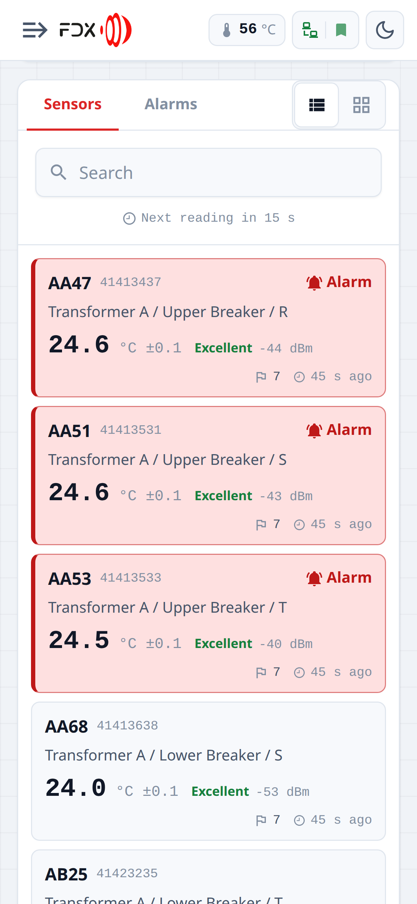
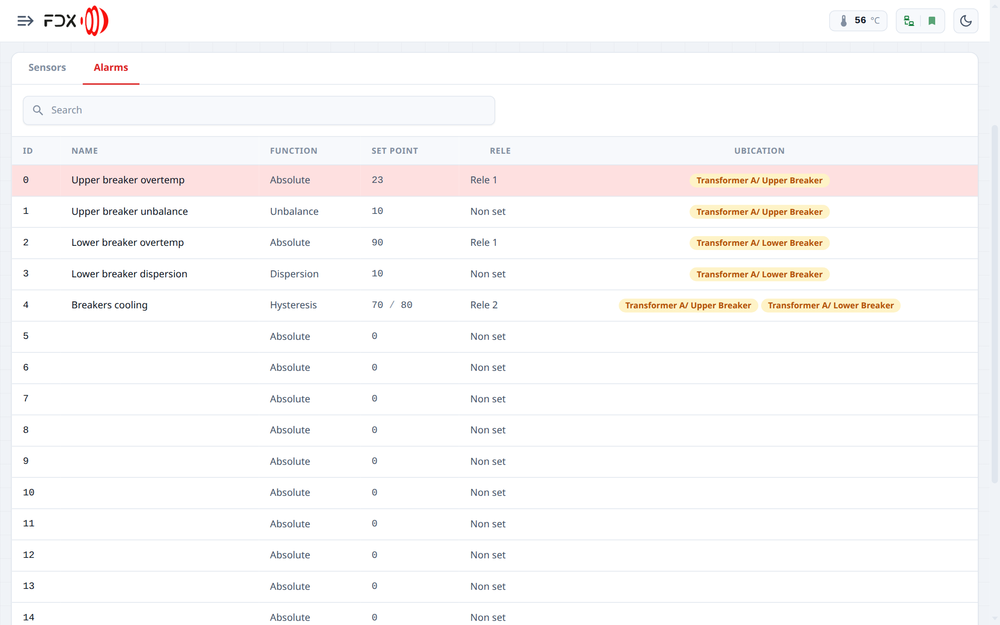

# Overview {#overview}

| | |
|---|---|
| **Ruta** | `/` (inicio) |
| **Menú** | **Overview** |

La vista Overview es la pantalla principal de monitoreo. Todos los valores se actualizan en tiempo
real; no es necesario recargar la página.

## Tarjetas de resumen {#summary-cards}

| Tarjeta | Muestra |
|------|-------|
| **Active alarms** | Alarmas disparadas en este momento, sobre el total de alarmas **in use** (en uso: alarmas con una función y al menos una ubicación). Mientras haya alguna alarma activa aparece una campana. |
| **Sensors in alarm** | Sensores que están causando una alarma activa, sobre el total de sensores configurados. |
| **Lowest temp** | La temperatura más baja entre los sensores configurados, con el nombre del sensor. |
| **Highest temp** | La temperatura más alta entre los sensores configurados, con el nombre del sensor. |

Un sensor que deja de informar conserva su última temperatura real en **Lowest temp** y
**Highest temp**, de modo que un sensor sobrecalentado que pierde la señal no desaparece del
resumen. Los sensores que nunca informaron un valor no se contabilizan.

## Panel de relés {#relay-panel}

El HS dispone de tres relés de salida. El panel muestra cada uno con una lámpara de estado:

| Relé | Contacto | Comportamiento |
|-------|---------|----------|
| **Relay 1** | **NO** (normal abierto, NA) | **On** mientras cualquier alarma asignada a Relay 1 esté activa. |
| **Relay 2** | **NO** (normal abierto, NA) | **On** mientras cualquier alarma asignada a Relay 2 esté activa. |
| **System** | **NC** (normal cerrado, NC) | **OK** mientras el lector RFID funcione y todos los sensores configurados estén leyendo. **Fault** en caso contrario. |

Debajo de cada relé se puede leer:

- el estado físico del contacto y cuánto tiempo lleva en ese estado, por ejemplo
  **Contact closed for 12 min**;
- para los relés 1 y 2, cuántas alarmas lo accionan (**2 alarms**, **No alarms**);
- para el relé System en **Fault**, el motivo, en el orden en que debe verificarlo:

| Motivo | Significado |
|--------|---------|
| **Reader offline** | El lector RFID no responde. |
| **No antenna** | El lector RFID no encontró ninguna antena conectada. |
| **Reader fault** | El estado del lector RFID es desconocido. |
| **No sensor reading** | Ninguno de los sensores configurados está informando. |
| **N sensors down** | N sensores configurados están fuera de servicio. |
| **Cabinet incomplete** | Solo en Auto mode: una antena no tiene un grupo de sensores completo. |
| **Check sensors** | Otro problema de sensores. |

**Waiting** indica que el relé aún no fue accionado desde el arranque del equipo.

## Grupos activos (solo Auto mode) {#active-groups-auto-mode-only}

Esta tarjeta aparece solo cuando el equipo opera en **Auto mode**. Cada
antena muestra el grupo EPC de sensores actualmente fijado a ella. Mientras se detecta un grupo
nuevo, la tarjeta muestra los grupos candidatos y sus votos, por ejemplo `A4·5  B2·1`.

- **Set &lt;group&gt;**: fija de inmediato el candidato que va primero, en lugar de esperar a que
  termine la ventana de detección. Una ventana de detección posterior todavía puede cambiarlo.
- **Fast detection**: acelera la detección de grupos durante 3 minutos, útil durante la puesta en
  servicio. Mientras está activa se muestran una cuenta regresiva y un botón **Stop**; se desactiva
  sola al finalizar el tiempo.

Es posible que un tag no aparezca si su EPC no pudo decodificarse correctamente.

## Pestaña Sensors {#sensors-tab}

Hay dos vistas disponibles, que se seleccionan con los botones en la parte superior derecha de la
pestaña. Su navegador recuerda la última que utilizó.

**Vista de lista**

| Columna | Contenido |
|--------|---------|
| **ID** | Identificador interno del sensor. |
| **EPC** | Nombre del sensor (decodificado a partir del EPC del tag). |
| **Equipment**, **Location**, **Position** | Dónde está instalado el sensor (ver [Labels](labels.md)). |
| **Temp** | Temperatura promedio de la última ventana de medición y su desviación estándar. |
| **Quality** | Calidad de lectura (ver [Referencia](../99-reference.md#read-quality)) y nivel de señal en dBm. |
| **Updated** | Cantidad de lecturas en la última ventana y segundos desde la última temperatura válida. |

- Las filas de los sensores en alarma se resaltan en rojo.
- Escriba en **Search** para filtrar por cualquier texto visible (nombre, ID, etiquetas).
- **Next reading in N s** muestra el tiempo restante hasta la próxima medición.

**Vista de mapa**

El mapa dibuja un bloque por equipo, con las ubicaciones como filas y las posiciones como
columnas, de modo que la disposición coincide con el equipo físico. Cada celda muestra el nombre
del sensor, la temperatura, la calidad, la cantidad de lecturas, la antigüedad de la última
temperatura válida y su slot Modbus. Junto a cada ubicación, **Δ N °C** es la diferencia entre su sensor más
caliente y el más frío, una forma rápida de detectar un punto más caliente que los demás.

Las celdas marcadas como **Empty** no tienen sensor. Un bloque con una alarma activa muestra una
marca **Alarm**. Los sensores cuya ubicación o posición no tiene etiqueta solo se muestran en la
vista de lista.

En los teléfonos, la vista de lista muestra una tarjeta por sensor en lugar de una tabla.

## Pestaña Alarms {#alarms-tab}

Una lista de solo lectura de las alarmas (ver [Alarms](alarms.md) para las columnas). Las alarmas
activas se resaltan en rojo. Haga clic en una alarma para desplegar los sensores que vigila con
sus valores en tiempo real; haga clic nuevamente para contraerla.

