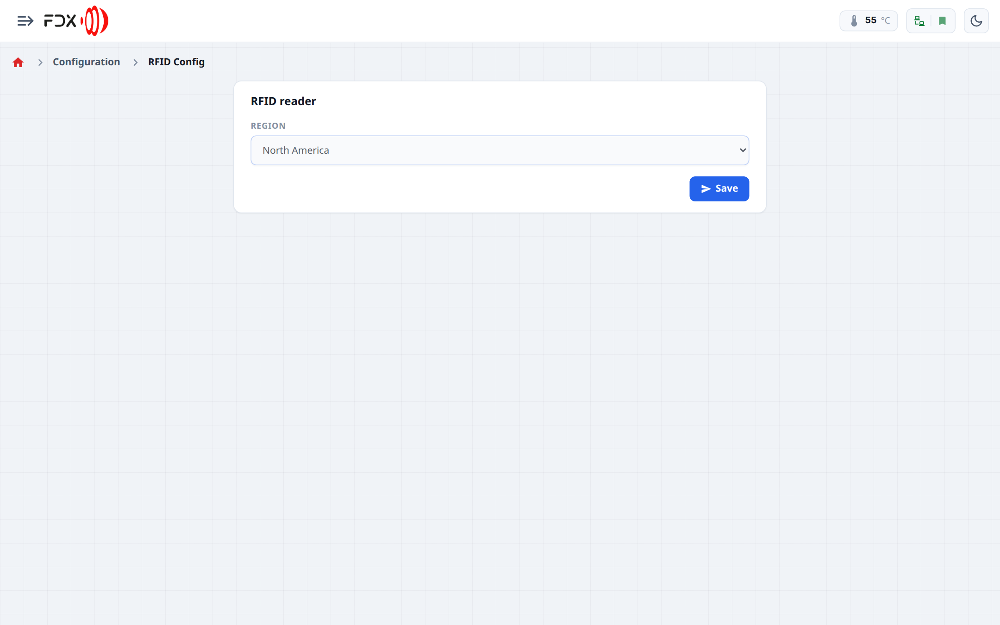

# Configuración RFID {#rfid-config}

| | |
|---|---|
| **Ruta** | `/configuration/readerConfig` |
| **Menú** | **Configuration > RFID Config** |

Ajustes del lector RFID que se comunica con los sensores.

| Campo | Valores | Descripción |
|-------|--------|-------------|
| **Region** | North America, Europe | Banda de radiofrecuencia permitida en su país. Seleccione la región donde está instalado el equipo. |

Presione **Save** para aplicar.
