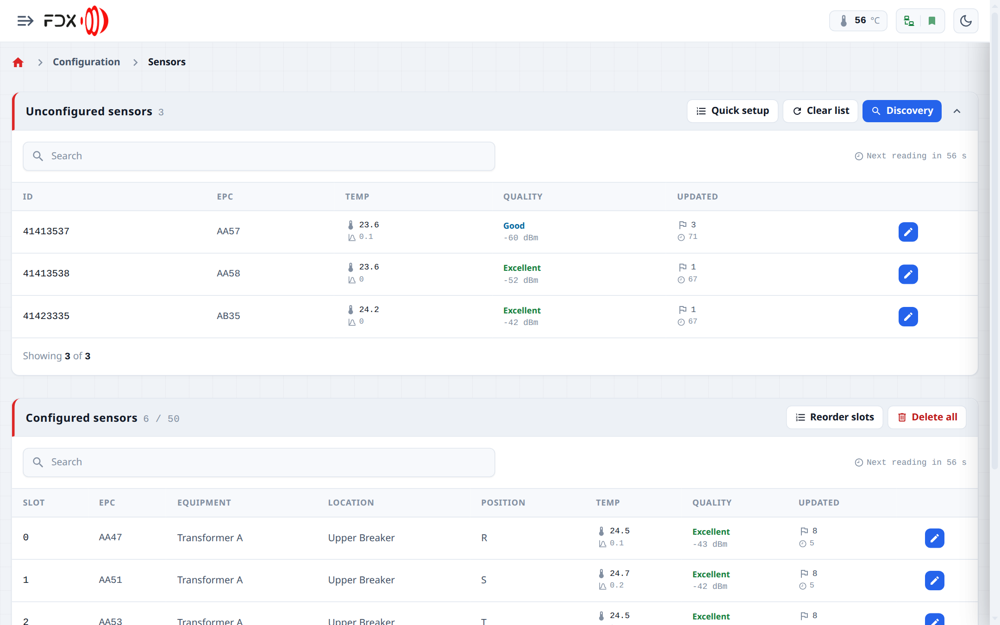
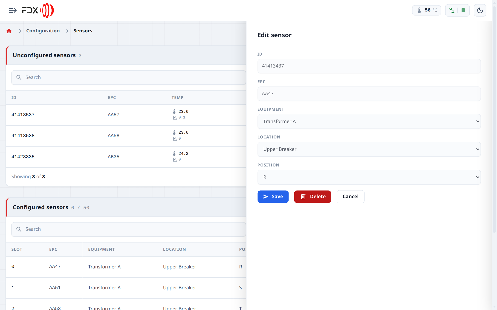
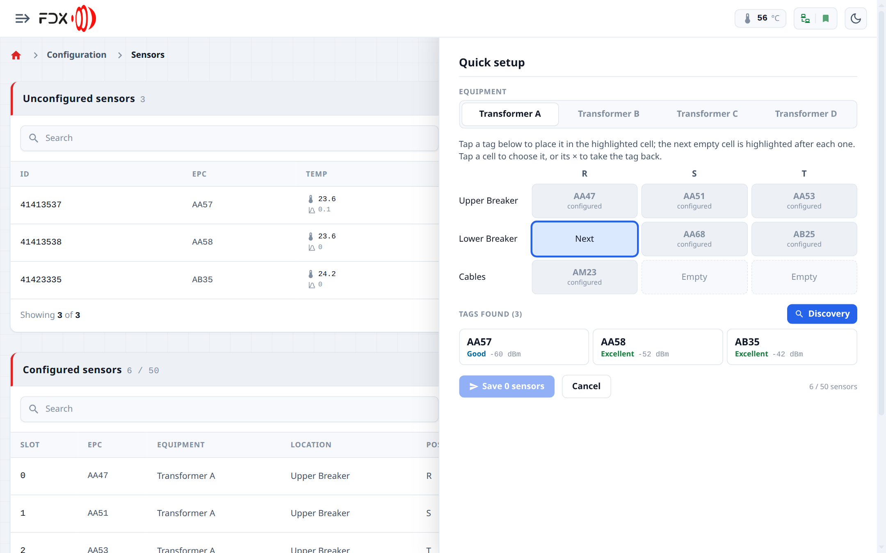

# Sensores {#sensors}

| | |
|---|---|
| **Ruta** | `/configuration/sensors` |
| **Menú** | **Configuration > Sensors** |

Registra los sensores RFID de temperatura y asigna a cada uno su lugar. Un sensor está
**configurado** cuando tiene un equipo, una ubicación y una posición; solo los sensores configurados
se monitorean, disparan alarmas y se publican por Modbus. El equipo admite hasta **50** sensores
configurados.

Defina primero los nombres en [Labels](labels.md).

## Sensores no configurados {#unconfigured-sensors}

Tags leídos por las antenas que todavía no están configurados. El número junto al título indica
cuántos hay; el botón de flecha contrae o expande la lista.

| Botón | Acción |
|--------|--------|
| **Discovery** | Comienza a escuchar todos los tags dentro del alcance de las antenas. Los tags nuevos aparecen en la lista a medida que se leen. Mientras está en curso, el botón pasa a ser **Stop discovery**. |
| **Quick setup** | Abre el panel de ubicación masiva (configuración rápida, ver más abajo). |
| **Clear list** | Vacía la lista de tags no configurados. Los tags que sigan dentro del alcance vuelven a aparecer en el siguiente descubrimiento. |

Durante el modo de descubrimiento, la lista muestra el nivel de señal de cada tag como barras en
lugar de la calidad de lectura (ver [Referencia](../99-reference.md#signal-level-during-discovery)).
El modo de descubrimiento se detiene al salir de la vista.

## Configuración de un sensor {#configuring-one-sensor}

1. Presione **Discovery** y espere a que aparezca el tag.
2. Haga clic en su fila (o en su tarjeta, en un teléfono). Se abre el panel **Edit sensor** a la derecha.
3. Elija su **Equipment**, **Location** y **Position**. Los campos **id** y **epc** son de solo lectura.
4. Presione **Save**. El sensor pasa a **Configured sensors**.

El panel le advierte cuando:

- se alcanzó el límite de 50 sensores: elimine un sensor antes de agregar otro;
- otro sensor ya tiene el mismo equipo, ubicación y posición: al guardar se sobrescribe ese
  lugar.

## Configuración rápida {#quick-setup}

Ubica muchos tags a la vez en una grilla de ubicaciones (filas) y posiciones (columnas).

1. Presione **Quick setup**.
2. Seleccione el **Equipment** en la parte superior.
3. La celda resaltada (**Next**) es donde se ubicará el siguiente tag. Toque un tag en **Tags found**
   para ubicarlo allí; la siguiente celda vacía se resalta automáticamente. Toque cualquier celda
   vacía para elegirla en su lugar. En una computadora también puede arrastrar un tag a una celda.
4. Para retirar un tag, presione la **×** de su celda.
5. Cambie de equipo para seguir ubicando; un contador verde en cada equipo muestra los tags
   ubicados pero aún no guardados.
6. Presione **Save N sensors** para guardar todas las ubicaciones a la vez, o **Cancel** para descartarlas.

Las celdas marcadas como **configured** ya contienen un sensor y no se pueden usar. Si **Tags found**
está vacío, presione **Discovery** dentro del panel. El contador de la parte inferior muestra el
total frente al límite de 50 sensores.

## Sensores configurados {#configured-sensors}

La lista de sensores monitoreados, ordenada por **Slot** de Modbus, con los mismos valores en tiempo real que la vista [Overview](overview.md). El slot es la posición del sensor
en el mapa de registros Modbus (ver [Modbus](modbus.md)).

| Acción | Cómo |
|--------|-----|
| Editar un sensor | Haga clic en su fila o en el botón de edición. Cambie el lugar y presione **Save**. |
| Eliminar un sensor | Ábralo y presione **Delete** en el panel de edición. El sensor deja de monitorearse y su slot queda libre. |
| **Reorder slots** | Renumera los slots de todos los sensores configurados, ordenados por equipo, ubicación y posición, y elimina los huecos. Ejecútelo una vez finalizada la instalación. **Cambia la dirección Modbus de los sensores**: se debe actualizar el SCADA o el maestro. |
| **Delete all** | Elimina todos los sensores configurados, previa confirmación. Los tags que sigan dentro del alcance vuelven a aparecer como no configurados. |

Un sensor conserva su slot, por lo que agregar o eliminar sensores más adelante no mueve a los
demás. Eliminar sensores deja huecos en la numeración de slots hasta que ejecute **Reorder slots**.
