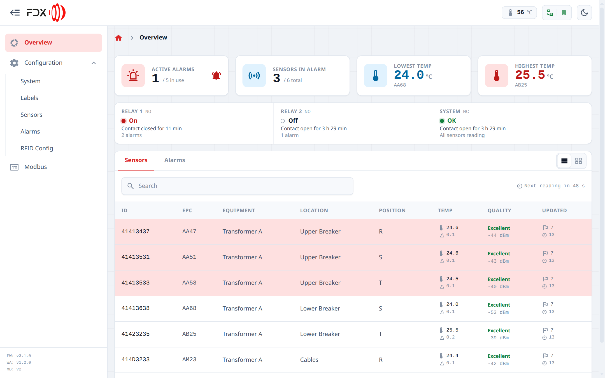

# Estructura de la aplicación {#application-shell}

| | |
|---|---|
| **Ruta** | Presente en todas las vistas |

La estructura de la aplicación es el marco que rodea a cada vista: la barra superior, el menú
lateral, la ruta de navegación, el aviso del lector RFID y las notificaciones.

## Barra superior {#top-bar}

De izquierda a derecha:

| Elemento | Descripción |
|---------|-------------|
| Botón de menú | Abre y cierra el menú lateral. |
| Logo FDX | Recarga la aplicación y vuelve a la vista **Overview**. |
| Temperatura de la placa | Temperatura interna del HS, en °C. |
| Indicador de conexión | Verde: la página está recibiendo datos en tiempo real. Rojo: se perdió la conexión; la página reintenta automáticamente. |
| Indicador de modo | El modo de operación actual del equipo (ver más abajo). Pase el cursor sobre él para leer su nombre. |
| Botón de tema | Alterna entre el tema claro y el tema oscuro (ver [Tema claro y tema oscuro](../00-introduction.md#light-and-dark-theme)). Su navegador recuerda la elección. |

## Indicador de modo {#mode-indicator}

| Ícono | Modo | Significado |
|------|------|---------|
| Marcador | **Manual mode** | Operación normal. Solo se procesan los sensores registrados. |
| Gabinete | **Auto mode** | Los grupos de sensores se registran automáticamente por antena. |
| Lupa | **Discovery mode** | Se listan todos los tags al alcance, para registrar sensores nuevos. Se inicia desde [Sensors](sensors.md). |

## Menú lateral {#side-menu}

| Entrada | Vista |
|-------|------|
| **Overview** | [Overview](overview.md) |
| **Configuration > System** | [System](system.md) |
| **Configuration > Labels** | [Labels](labels.md) |
| **Configuration > Sensors** | [Sensors](sensors.md) |
| **Configuration > Alarms** | [Alarms](alarms.md) |
| **Configuration > RFID Config** | [RFID Config](rfid-config.md) |
| **Modbus** | [Modbus](modbus.md) |

En la parte inferior del menú se muestran las versiones del equipo. Indíquelas al contactar al
soporte técnico:

| Línea | Significado |
|------|---------|
| **FW** | Versión de firmware del HS. |
| **WA** | Versión de la aplicación web. |
| **MB** | Versión del mapa de registros Modbus (contrato). |

En teléfonos, tablets y ventanas angostas el menú se abre sobre la página y se cierra al elegir
una entrada.

## Ruta de navegación {#breadcrumb}

Debajo de la barra superior, la ruta de navegación indica dónde se encuentra, por ejemplo
**Configuration > Sensors**. El ícono de la casa vuelve a la vista Overview.

## Aviso del lector RFID {#reader-banner}

Este aviso puede aparecer en la parte superior de cualquier vista:

| Aviso | Significado | Qué hacer |
|--------|---------|------------|
| Aviso rojo del lector: "The reader is not responding", "No antennas detected" o "Antenna state unknown" | El lector RFID no está funcionando y el equipo no está midiendo. | Verifique los cables de las antenas. El HS reintenta la detección automáticamente; si el aviso no desaparece, contacte al soporte técnico. |

## Notificaciones {#notifications}

Los resultados de sus acciones aparecen como pequeños mensajes en la esquina inferior derecha:

- **verde**: la acción se completó correctamente;
- **ámbar**: la acción se ejecutó pero el resultado requiere su atención (por ejemplo, no se encontraron antenas);
- **rojo**: la acción falló, por ejemplo porque se perdió la conexión o el equipo rechazó un valor.

Cierre un mensaje con su **×**.

## Cambios sin guardar {#unsaved-changes}

Las vistas con formulario (System, Labels, RFID Config) le advierten si intenta salir con cambios
que aún no se guardaron. Elija quedarse y guardar, o salir y descartarlos.
