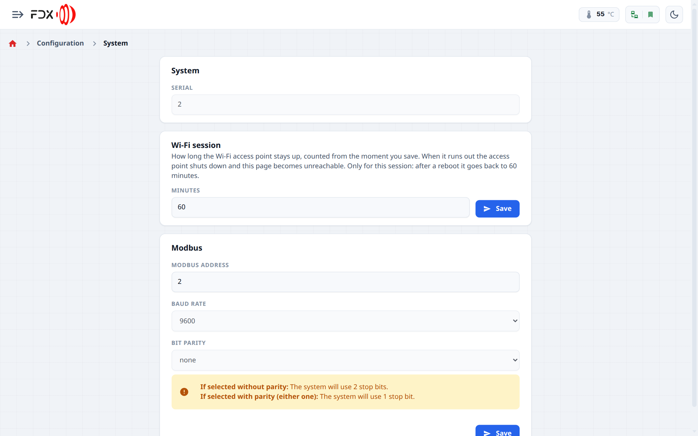

# System {#system}

| | |
|---|---|
| **Ruta** | `/configuration/system` |
| **Menú** | **Configuration > System** |

Configuración general del equipo.

## Tarjeta System {#system-card}

Muestra el número de serie (**Serial**) del equipo (solo lectura).

## Sesión Wi-Fi {#wi-fi-session}

Define cuánto tiempo permanece encendido el punto de acceso Wi-Fi, contado desde el momento en que
presiona **Save**.

| Campo | Rango | Notas |
|-------|-------|-------|
| **Minutes** | 1 a 1440 | Se aplica solo a la sesión actual. Después de un reinicio, el equipo vuelve a 60 minutos. |

Cuando se agota el tiempo, el punto de acceso se apaga y ya no es posible acceder a la página.
Presione nuevamente el botón Wi-Fi del HS para volver a conectarse.

## Modbus {#modbus}

Configuración del enlace Modbus RTU (RS-485) hacia el sistema SCADA o maestro. Debe coincidir con
la configuración del maestro.

| Campo | Valores |
|-------|--------|
| **Modbus address** | 1 a 247 |
| **Baud rate** | 9600, 19200, 38400, 57600, 115200 |
| **Bit parity** | none, odd, even |

La cantidad de bits de parada depende de la paridad: **none** utiliza 2 bits de parada; **odd** o
**even** utilizan 1 bit de parada. Presione **Save** para aplicar.
